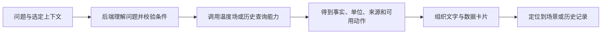

# 温度场智能助手页面开发交接

更新日期：2026-10-18。导航预留路径：`/assistant`。当前尚未实现页面与问答接口。

开发前先阅读[共同设计与开发约定](00-shared-ui-guidelines.md)。本文给出可讨论的功能方向和技术组织建议，具体对话模型、交互比例、接口名称和首期范围由团队决定。统一外壳、数据依据和视觉语言是交付时需要共同保持的部分。

## 1. 页面目标与当前基础

助手帮助用户用自然语言找到温度场中的信息，并理解当前图像和模型结果。回答应能回到系统中的数据、位置或图表，让用户继续观察。

目前已经完成：实时导航原“三维可视化”替换为“温度场智能助手”，使用 `chat` 线框图标，仍标为尚未开放。当前没有 `AssistantView`、自然语言解析、问答服务、会话存储或大模型调用配置；这些均属于后续工作。

可以复用的基础包括实时帧、体网格、模型详情、坐标查询、读数分级和三维视图。但现有 `SectionAsk` 和 `VolumeView` 的“查一个坐标”是结构化查询功能，不能直接当作已经具备自然语言问答。

## 2. 功能候选与分阶段建议

建议优先做少量能查证的问答，再逐步加入历史分析。以下是候选项，不要求同时上线。

| 方向 | 示例问题 | 数据与实现条件 |
| --- | --- | --- |
| 当前场概览 | “这一刻棚内均温是多少？” | 复用监测摘要及其统计采样策略 |
| 位置查询 | “x 为 0、y 为 6、z 为 0.6 米处多少度？” | 明确坐标、查询有效区域，返回实际吸附格点 |
| 图像解释 | “为什么棚顶有一部分没有颜色？” | 结合几何与无测量带规则解释 |
| 模型解释 | “这张图用了哪个模型？” | 后端补齐实时管线实际使用的模型元信息 |
| 空间比较 | “前部和后部哪里更热？” | 先明确区域定义，再由后端按统一口径统计 |
| 高点定位 | “这一刻最热的位置在哪里？” | 增加有效区域极值计算，返回位置、数值和统计范围 |
| 历史分析 | “过去两小时温度变化怎么样？” | 历史来源、时间范围和查询接口可用后再接入 |
| 分析结果整理 | “总结这段时间的温度分布” | 有可追溯的数据集合后再组织文字或报告 |

首期建议从当前概览、坐标查询、图像解释中选取最小闭环。是否接入语言模型、先使用模板问答，或混合使用，两者都可评估；界面应如实呈现实际支持范围。没有接入问答能力时只展示清楚标注的原型状态。

“为什么升温”需要区分观察到的事实和可能的解释。当前温度场和气象数据能够支持描述与关联分析，不能自动证明通风、遮阴等因素的因果关系。未来温度预测、栽培处方和设备控制需另行定义需求与依据。

## 3. 页面布局与风格

### 3.1 共用外壳

沿用实时工作台的系统顶栏、模式开关和左导航。在注册 `/assistant` 时同步改造实时工作区识别，详见共同约定第 4 节。主题应在图表读取调色板前准备好，避免首次进入时呈现训练模式的浅色样式。

### 3.2 推荐布局，可按实际内容调整

```text
主内容区
┌ 页面标题与当前分析对象说明 ──────────────────────────────┐
│ 已选择的来源 / 数据时刻 / 模型 / 位置（紧凑上下文条）      │
├ 对话区域，独立滚动 ────────────────────┬ 关联信息，可选 ──┤
│ 推荐问题或已有对话                     │ 选点、断面预览   │
│ 回答：文字结论 + 数值卡 + 可展开证据    │ 数据与模型出处   │
│ 查看此位置 / 查看历史等可用动作         │                  │
├ 输入框、发送、生成中与取消状态 ─────────┴──────────────────┤
└───────────────────────────────────────────────────────────┘
```

关联信息可以放右栏、回答内卡片或抽屉，视空间而定；不要求首期常驻一整块三维场景。输入区在可见范围内，长对话在消息区域滚动，长回答和证据有明确展开方式。

具体视觉要求：

- 回答卡、引用数据和输入区沿用 `--card`、`--card-2`、`--steel` 和共同圆角；主操作使用 `--interact`。
- 页标题和正文沿用字号层级；输入问题与回复以对齐、标签和层次区分，避免另建一套字体和高饱和气泡配色。
- 温度、坐标和时间使用共用格式；证据说明使用次要文字，仍需保持可读。
- 推荐问题可以做紧凑按钮或卡片，使用既有线框图标；加载时保留消息占位，避免整页上下跳动。
- 回答中的图表沿用监测页的色标与坐标风格；真正的时间趋势明确写时间轴，空间曲线明确写棚位轴。

## 4. 问答上下文与数据依据

每次提问需要绑定当时的分析对象。页面可以默认跟随实时监测的最新帧，但发出问题后，应固定该问题的数据时间、来源和模型；实时源继续播放不能悄悄替换已显示答案的依据。

建议呈现“本次回答基于某时刻的数据”。用户切换来源、时间或位置后，新问题使用新上下文，旧答案保留自己的出处。若存在新帧，可提供“基于最新数据再问一次”的操作。

团队需要对齐的上下文信息见共同约定第 5.3 节。实现时特别注意：

- 当前接口没有完整的稳定快照标识和实际运行模型标识，需要后端补齐，不能由助手自行推断。
- 用户没有指定时间时，清楚说明采用的是当前可用数据时刻；“今天”“刚才”等相对时间需要明确时区和基准。
- “棚前部”“棚后部”“这附近”等词有歧义时，可通过轻量追问或范围选择确认。区域边界示例可由团队约定，不在文档中固定。
- 传感器直接读数、重建格点值、沿棚混合断面和区域统计分别标明来源。
- 越界、拱外、无测量带和普通可报告值应沿用系统判定。已有外推数组元素并不意味着可以对无测量带报出温度。
- 不把模型验证指标当成当前帧的实时误差或每个位置的置信度；当前没有逐格置信区间时，不生成这种数值。
- 缺少历史接口、未来预测能力或所问记录时，说明数据边界并给出可行的下一步。

## 5. 推荐服务组织方式

建议把一条问题拆成“识别问题与条件、调用受控的数据能力、形成可追溯结果、组织回复”。计算服务既可为助手使用，也可供监测页和历史页复用。



推荐的数据能力候选为当前摘要、坐标查询、有效区域统计、模型解释和历史趋势。它们的实现和命名可调整，业务计算应集中在后端。语言模型如参与解析，也只提交经过校验的结构化条件；后端校验来源、时间、坐标和工具参数后再执行。

模型厂商、是否本地部署、同步回复或流式回复、会话保存范围均不在本文锁定。若使用外部服务，调用配置与密钥放在后端，前端只访问本系统问答接口。需要保存会话时，先明确保存多久、如何删除及数据出处如何随消息一起保留。

## 6. 接口讨论草案

当前没有 `/api/assistant/*` 接口。以下只是帮助前后端对齐职责的示例，字段、路径和拆分方式可修改；新增接口时在 OpenAPI、前端类型及本文同步记录。

例如使用 `POST /api/assistant/ask`，由请求提供问题、可选会话标识、选定上下文。若服务端引入 `snapshot_id`，可优先以稳定标识引用数据，避免每次传输整个体网格。

建议响应至少表达以下信息：

| 信息 | 用途 |
| --- | --- |
| 完成状态 | 区分已回答、需要补充条件、暂无数据、能力未支持 |
| 文本回答 | 用于解释结果，不承担唯一的数据表达 |
| 结构化事实 | 值、单位、实际位置或区域、有效性与计算口径 |
| 数据依据 | 来源、数据时间、实际模型与统计设置；可关联快照 |
| 展示动作 | 定位、查看断面、打开历史等经过校验的目标 |
| 请求关联标识 | 防止取消、重试、流式事件串到另一条消息 |

若采用流式回复，建议分别传递状态、文本和最终事实；前端能够取消、恢复输入和显示中断。工具未完成时，不先输出一个看似确定的数值，再由后续文本修正。

极值、区域均值和历史聚合尚无专用通用接口，需要新建或扩展后端服务；不能把当前 `vmin/vmax` 色标范围直接包装成“最热位置”的结果。

## 7. 与另外两页的联动

| 发起位置 | 建议动作 | 必须带上的内容 |
| --- | --- | --- |
| 实时页已选中格点 | 询问此位置 | 来源、数据时间、实际吸附坐标、模型和计算设置 |
| 助手的空间回答 | 在温度场中查看 | 同一分析对象与位置，目标不可用时给出说明 |
| 助手的历史回答 | 查看这段记录 | 历史来源、时间范围、位置或测点、记录标识 |
| 历史页已选记录 | 解释这条记录 | 记录标识、原始模型或明确的重算设置 |

目前 `VolumeView` 主要管理组件内部的查询与钉住状态，对外联动还需要输入/事件设计。可以渐进增加选点输入、定位事件或共用上下文组合函数；动作通过类型化数据执行，避免把任意回复文本当成跳转或场景命令。

从实时页打开助手时，不自动暂停或推进实时源；返回监测页时，若原提问时刻已落后于最新画面，应明确是查看当时对象还是继续当前监测。

## 8. 建议开发顺序与页面状态

建议按纵向闭环推进：

1. 使用共同外壳完成页面骨架、上下文条、推荐问题、消息与输入状态。模拟回复需要标明为演示。
2. 接入一个真实的摘要或坐标查询能力，使每个答案有可验证的数据依据。
3. 再加入自然语言解析和解释，按需要选择模型或模板方案。
4. 接入图表定位和历史查询，继续扩展空间统计等候选能力。

应覆盖的状态包括初次进入、上下文未准备、提问条件不完整、生成中、成功、无数据、能力未支持、服务失败、取消或中断。重试不重复创建多条同一问题；来源变化不会让旧请求覆盖新上下文。对于暂未支持的建议问题，页面标明能力边界。

## 9. 建议验收与代码入口

- 从监测页携带位置提问，答案能还原同一时间、位置和模型依据。
- 已知坐标与现有数值查询结果一致；统计口径采用相同采样设置。
- 越界、拱外、无测量带、空值和歧义问题都有正确表达，缺失数据不补成结果。
- 实时帧继续更新时，先前答案及其出处保持一致；切换上下文后不会显示错位回复。
- “为什么升温”等解释能区分事实与推断，不生成不存在的误差、置信度或历史记录。
- 对话滚动、输入框、长文本、数值卡片、焦点和加载状态在桌面与窄屏可用，风格与实时页一致。
- 导航与直接刷新正确，离页后清理流连接或请求状态。问答不会调用实时播放控制接口改变游标。
- 自动验证建议覆盖结构化结果与来源、工具参数校验、并发/取消和关键页面状态；人工检查对话可读性及图表联动。

复用入口：[LiveView.vue](../../frontend/src/views/LiveView.vue)、[SectionAsk.vue](../../frontend/src/components/SectionAsk.vue)、[VolumeView.vue](../../frontend/src/scene/VolumeView.vue)、[pick.ts](../../frontend/src/charts/pick.ts)、[types.ts](../../frontend/src/api/types.ts)、[routes/field.py](../../backend/api/routes/field.py)、[routes/models.py](../../backend/api/routes/models.py)。

待团队讨论：首期真实支持的问题、模型或模板选择、上下文固定方式、会话是否持久化、联动采用整页还是抽屉、用户可访问的数据范围。讨论结果应补入契约，不需要提前把所有候选功能做成固定菜单。
