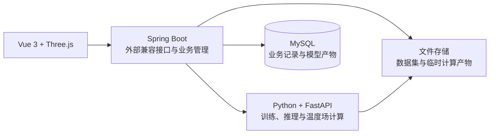

# Spring Boot 与 Python 分工迁移计划

更新日期：2026-10-19。适用项目：棚式空间温度场重建系统。

状态：已完成当前单机核心迁移与部署切换。当前工作区已实现 Spring Boot 业务管理、Python 明确上下文计算、实时会话及恢复，并通过真实训练、模型和实时核心流程联调；生产运维、压力和更多故障窗口按实际环境继续安排。原始参考基线为 `main` 的 `8bd24c1`。

当前实施进度：

- 阶段 0：已导出 28 条接口的 OpenAPI 契约，完成本机模型表与数据文件备份，并采集当前数据与温度场样例。训练、取消和保存等完整写入流程的对比记录仍需后续联调补充。
- 阶段 1：Java 兼容接口、请求日志、依赖检查、Maven Wrapper 与前端可切换代理已加入。详见 [Java 服务说明](../../backend-java/README.md)。
- 阶段 2：已实现 Java 数据集接收与登记、MySQL 默认工作区、不可变文件版本及 Python 请求上下文；已启用 Flyway V1，旧模型表保持原样。详见 [数据集与工作区协议](contracts/dataset-workspace-v1.md)。
- 阶段 3：训练、去重、取消、结果暂存和保存事务已接入；阶段 5 已补充真实训练、跨重启保存与取消联调。见 [训练和模型协议](contracts/training-models-v1.md)。
- 阶段 4：实时源副本、固定模型、游标、恢复及操作回执已接入；阶段 5 已补充非零帧恢复、重复步进、失联与真实自动播放检查。见 [实时会话协议](contracts/live-sessions-v1.md)。
- 阶段 5：已完成 Windows 单机统一构建、启动、停止、日志、同源静态部署、发布包回退及核心流程联调；运维和容量边界见 [部署交接](05-deployment-and-acceptance.md) 及 [实际记录](06-migration-acceptance-20261019.md)。

### 本轮实际检查记录

2026-10-19：

- Java 17、Spring Boot 3.5.16、Maven 3.9.16；Java 编译打包和 Maven Wrapper 启动成功，前端构建成功。
- 对照了 13 组实际 HTTP 请求，覆盖健康检查、模型列表、数据集、几何、断面、三维卷、温度曲线、实时状态、非法模型编号、未知路径、无效模型保存输入、中文文件名上传拒绝和不支持的方法。返回状态及 JSON 内容一致，构场耗时字段单独处理。
- 通过 Java 实际导入同一份 XLSX，确认原始上传与中文文件名可用；随后恢复原文件修改时间，保持当前数据集原签名。
- Python 加载日志中间件后已恢复当前数据集和原实时暂停状态；重启前后的温度场样例数值一致，比较时排除 `elapsed_ms`。
- 前端 5173 发出的独立请求编号同时出现在 Java 和 Python 日志中，确认实际调用链已经切换。
- 本轮未运行 pytest、Vitest 或 Java 测试套件，未重新提交真实训练或保存新模型；取消与保存等完整写入链路仍需后续验收。

### 阶段 2 实施与运行记录

2026-10-19，Java 业务服务 0.2.0：

- 新增 JDBC / MySQL / Flyway，创建 `dataset_record`、`workspace_context` 和独立迁移历史表；首次接管原数据时保留原文件名及签名。
- 上传文件按 UUID 独立保存，SHA-256 校验通过后提交登记和选择事务；新增数据集列表、工作区查询与切换接口，旧上传接口保留响应结构。
- Java 为数据相关计算补充内部凭据和数据引用；Python 使用 ContextVar 隔离请求，训练执行线程继承提交上下文，未保存结果按数据集筛选。训练提交与工作区切换在单 Java 实例中协调，训练中切换返回冲突。
- Java 编译打包成功，Python 源文件语法解析通过；MySQL 8.0.46 上完成 V1 增量迁移，后续启动无需重复建表。前端本阶段未改动页面。
- 实际导入同一份 XLSX 形成新版本，确认新版本被选中；无效 XLSX 返回 400，工作区保持不变；通过新接口切回原版本。
- 随后重启 Java 和 Python，工作区记录与原数据集元数据保持一致，无需重新上传。Python 独立入口为 409 空态，经过 Java 仍能加载已登记数据。
- 经前端 5173 → Java 8080 → Python 8503 读取 `t_index=0`、`preset=interactive`、`monotonic=true`、`y_step=3` 的体数据；除耗时字段外，与迁移前样例相同。Java 与 Python 日志保留同一请求编号。
- 独立实时管线已手动重新准备并恢复原暂停游标；这属于升级恢复操作，尚未实现实时会话自动持久化。
- 更新后的基线采集工具已生成模型表、数据集、工作区、Flyway 表 SQL / JSON 和默认目录文件副本；原有 1 条模型记录未改写。备份存于本机被忽略的 `.local/migration/`。
- 本阶段未运行自动测试套件，未重新训练、取消真实训练或保存新模型，也未演练备份向新库恢复。完整并发、断连及故障验收继续按第 7 节安排。

阶段 2 时工作区选择已持久化，其他状态仍沿用原实现。前端暂未增加数据集版本选择界面，可通过新接口管理已登记版本。

### 阶段 3 实施与运行记录

2026-10-19，Java 业务服务 0.3.0：

- V2 增量建表成功，新增 `training_job` 与工作区模型、最近任务、当前结果引用；原模型 ID、标定包和二进制不改写。MySQL 运行槽约束维持一个运行任务。
- Java 创建稳定任务编号，保存数据集、参数和配置摘要；支持可选幂等键，提交响应不确定时核对同一编号，不创建第二次执行。
- 前端训练提交自动携带幂等键，网络或服务响应不确定时保留键供原页面重试；明确区分运行冲突和输入冲突。页面布局保持原样，前端构建通过。V3 将请求键设为区分大小写。
- Python 增加受内部凭据保护的训练协议，持久化执行元数据和完成结果；取消确认后才成为 cancelled。Java 后台持续核对，暂时断联保留任务，Python 重启中断的执行明确失败。
- 默认模型库模式已切换为 java，Python 原 SQL 写入口与公开保存、选择入口停用；列表和详情仍由 Python 生成原有展示结构，记录和原始产物通过 Java 内部只读接口取得。
- 保存模型时 Java 校验摘要，在一个事务内写模型、关联任务、更新当前选择；同一任务重复保存返回原记录。计算请求明确绑定模型和未保存结果引用。
- Java 编译打包、Python 源文件解析通过；启用 0.3.0 后，原数据集、模型列表和标定展示与切换前一致。原模型通过 Java 原始产物接口恢复，训练三维样例与迁移前一致，比较时排除耗时。
- 独立实时管线在升级后重新准备，恢复原暂停游标；实时会话的自动恢复仍未实现。
- 基线工具补充训练表和默认暂存目录备份，按外键顺序生成 SQL，保留时间列并跳过数据库生成列。未演练向新库恢复。
- 本阶段未运行自动测试套件、未提交真实训练、未保存新模型，也未执行取消或断连故障演练。因此训练执行、结果跨重启保存和重复保存的完整写入链路仍需联调验收。

### 阶段 4 实施与运行记录

2026-10-19，Java 业务服务 0.4.0：

- 新增 `live_session`、`live_operation` 与工作区会话引用，MySQL 增量迁移到 V4；准备、播放和帧查询统一经过 Java 会话协调器。
- Python 保存每个会话的训练源、帧源副本及清单，绑定原模型 ID、包与成品摘要、算法源码摘要；已有会话不受默认源文件覆盖或当前模型切换影响。
- 开始、暂停、下一帧先在 Java 登记操作，再交给 Python 以稳定 UUID 执行和原子保存回执；未确认响应先核对原操作。状态轮询与场查询分开，自动播放仍每 300 秒推进一帧。
- Java 持久化最近确认游标；Python 重启后只加载资料，显式恢复时按原副本和模型重建到确认帧，完成后暂停。新会话先准备后切换，失败不替换原会话。
- 前端保持现有三维和底部布局，增加模型提示、“恢复实时源”及“重新准备”；新会话重挂载三维模块，请求附加期望会话引用，避免旧结果混入。
- Java 打包、前端类型检查与构建通过；已启动新服务，数据库、Python、内部训练和实时协议健康检查均正常。通过 5173 → 8080 → 8503 准备原模型与数据的会话，维持原第 0 帧暂停状态。
- 只读核对原数据集、模型列表和 144 帧、300 秒间隔保持一致；实时首帧三维载荷与升级前一致，比较排除 `elapsed_ms` 及新增 `session_id`。原有 1 条模型未新增或改写。
- 基线工具新增实时表、默认会话目录与回执备份，保留 SQL 外键顺序和生成列处理。本机升级后快照保存在 `.local/migration/20261019-215041-940988/`，包含 13 份文件和原有 1 条模型；这些本机数据未纳入 Git。备份恢复到新空库尚未演练。
- 本轮未运行自动测试、实际训练、保存、取消或长时间播放，也未演练重复步进、断联和非零帧重启恢复。上述协议已有实现，完整行为仍需阶段 5 联调验收。

### 阶段 5 实施与运行记录

2026-10-19，Java 业务服务 0.5.0：

- `scripts/system.ps1` 统一构建、启动、停止、重启及状态，生成含前端、Java、Python 和摘要的版本包；支持保留包回退，记录日志与进程身份，恢复调用终端环境变量。
- Java 在同一 8080 入口提供页面及 API，Python 仍在 8503 计算。首页与前端路由可刷新，缺失 API、静态文件保持错误响应；开发模式保留 Vite。
- 从业务快照向独立新库恢复，在独立端口完成真实完整训练、保存、取消、版本上传、模型切换、失联、训练重启失败、非零实时帧恢复、去重及真实 300 秒自动播放。
- HTTP 45 项、浏览器 9 项、Java / Python 载荷对照 10 组通过。前端 583 项通过；后端覆盖 507 项非 slow，完整运行中 1 次数据库连接超时在单项重跑后通过，104 项 slow 未运行。
- 实际检查并修复实时画布在 flex 列内继承左对齐导致宽度不足的问题，新增宽度断言；日常系统已切到统一部署，保留原数据与会话状态。
- 发布包切换与回退、重复启动不新增进程、端口占用拒绝和配置隔离已检查。完整证据、耗时样本及未覆盖窗口见 [联调记录](06-migration-acceptance-20261019.md)。

当前状态：数据、工作区、任务、模型、实时会话与操作由 Java 持久化；Python 暂存训练结果、实时源副本与回执。运行线程和计算管线仍在内存中，恢复过程需重新构建；这不等同于已经具备历史检索系统。单机核心流程已联调，运维及压力范围另行记录。

## 1. 迁移目标与范围

目标结构为：Vue 3 + Three.js 前端、Spring Boot 业务服务、Python + FastAPI 计算服务、MySQL 持久化。

- Spring Boot 统一面向前端的接口，管理数据集登记、工作区选择、训练任务记录、模型登记与选择，以及实时会话和操作确认。
- Python 保留数据检查、特征构造、训练、诊断、模型恢复、空间温度场计算和实时管线执行。
- 前端保持现有页面、布局、交互和数据含义；通过兼容接口逐步切换。
- 本轮完成已有功能的迁移。智能助手、历史查询、真实设备接入和用户权限属于后续业务开发，分别排期。
- 首轮采用一个默认工作区、一个 Python 计算实例，维持当前演示的使用规模。多用户隔离和计算集群作为后续扩展。

迁移完成的标志：前端经过 Java 服务能走通已有流程，Java 已接管约定的业务记录，Python 通过明确的数据集、模型、任务和实时会话标识进行计算。

## 2. 当前代码基线

| 部分 | 当前实现 | 迁移时的处理 |
| --- | --- | --- |
| 前端请求 | `frontend/src/api/client.ts`，主要使用 `/api` 相对路径 | 保持外部协议；切换开发代理后联调 |
| 类型约定 | `frontend/src/api/types.ts` | 作为字段、空值和状态约定的核对入口 |
| 后端接口 | 27 条业务接口，加 `/api/health`，共 28 条方法与路径组合 | 阶段 0 建立完整清单和响应样例 |
| 核心计算 | `backend/src/tfield/` | 继续在 Python 运行，初期复用现有算法与参数 |
| 当前数据集 | Java 数据集登记与 MySQL 默认工作区；Python 按请求绑定引用 | 已完成阶段 2；8503 旧入口保留独立内存选择 |
| 训练任务 | Java `TrainingService` / `training_job`；Python `managed_training.py` 执行及暂存 | 阶段 3 已实现；完整写入与故障验收待完成 |
| 模型库 | Java 读写 MySQL `model`；Python 经内部接口读取 JSON 和成品 | 已切换唯一写入方，保留旧记录与 ID |
| 模型格式 | `PipelineArtifact` 包含自定义头和 Python pickle 内容 | Python 解释和加载；Java 按不透明字节保存与传输 |
| 实时演示 | 独立 `train.xlsx`、`live.xlsx`，播放与管线状态在内存 | 迁移时保留独立数据源、帧号规则和播放语义 |
| 开发端口 | 前端 5173、Java 8080、Python 8503 | 当前前端默认访问 Java，可通过配置切回 Python |

当前 `dataset_signature` 由绝对路径、修改时间和文件大小组成，不能直接作为跨服务、跨机器的稳定身份。模型恢复还会根据当前数据重建残差，迁移时必须保留这一步。

## 3. 目标结构与所有权

### 3.1 最终职责

| 对象 | Java 负责 | Python 负责 |
| --- | --- | --- |
| 数据集 | 文件接收、登记、版本、校验状态、当前选择 | XLSX 结构与内容检查、数据解析、计算所需缓存 |
| 训练任务 | 任务编号、请求去重、状态记录、对外查询与取消入口 | 执行训练、报告进度、响应取消、产生结果 |
| 模型 | 名称、版本、登记、当前选择、持久化事务 | 生成标定包与产物、校验兼容性、加载并运行模型 |
| 温度场 | 解析业务上下文、调用计算、返回兼容响应 | 特征处理、残差、插值、约束、网格、均温与色标数据 |
| 实时会话 | 会话登记、绑定数据源与模型、对外操作入口 | 播放时钟、游标、逐帧接入、管线计算 |

Java 首轮可采用 Spring MVC，通过 `RestClient` 调用 Python HTTP 服务。Spring Boot 官方为普通命令式应用提供这一调用方式，团队锁定版本后再确定具体配置。[Spring Boot 官方说明](https://docs.spring.io/spring-boot/reference/io/rest-client.html)

### 3.2 数据写入的约定

- 阶段 1–2 过渡期模型表由 Python 写入；阶段 3 默认 java 模式已停用该写入口。
- 当前 Java 是 `model` 表和新增业务表的唯一写入方。Python 通过内部接口提供或获取模型产物。
- 首轮保留现有 `bundle` 与 `artifact` 存储列。Java 对产物字节不做反序列化，Python 保持加载流程。
- 每组业务表有明确写入方和切换时间；一次业务操作只走一条写入路径。
- 当前数据和模型选择归 Java 工作区管理，Python 接收明确的数据、模型和未保存结果引用。

这可以复用已有模型与数据库，模型产物改存对象存储的工作可另行安排。

## 4. 分阶段实施

以下估算为团队总投入的工作人日，假设有 1 名 Java、1 名 Python 开发，前端成员参与联调。合计约 20–34 人日，建议先按 4–6 周讨论排期；阶段 0 后结合成员投入和数据情况重估。

### 阶段 0：建立兼容基线，明确交接清单

**投入粗估：2–3 人日。主责：Java、Python、前端共同确认。**

1. 核对 28 条方法与路径组合，记录查询参数、默认值、请求体、成功响应、错误响应、状态码和超时特点。
2. 固定一份可用于对比的数据集、可恢复的模型，以及若干时间、网格位置和实时帧作为验收输入；实际数据留在本机受控存储中。
3. 记录上传、训练、取消、保存、切模型、断面、三维、实时准备与步进的完整操作结果。
4. 备份现有模型表、标定包和必要文件，记录代码提交与 Python 依赖环境。
5. 锁定兼容的 JDK、Spring Boot 和依赖版本，明确开发与部署方式。
6. 确认一名接口负责人，维护契约变更记录。

**交付物：** 接口清单、对比数据说明、备份位置与恢复步骤、版本与负责人清单。

**完成标准：** 团队可以明确回答每条请求由哪个模块处理，以及结果与旧系统如何对比。

### 阶段 1：搭建 Java 服务，先打通兼容调用

**投入粗估：3–5 人日。主责：Java；Python、前端配合。**

1. 在仓库增加 `backend-java/`，保留现有 `backend/` 路径，避免影响 Python 导入、脚本和数据定位。
2. Java 开发端口建议为 8080，Python 仍为 8503，通过配置指定 Python 服务地址。
3. Java 按清单转发现有 `/api` 请求，支持原始上传体、二进制流和 JSON 响应。转发范围限定为已登记接口。
4. 原样保留业务状态码、响应结构和 `detail` 错误字段，避免统一包成新的 `Result<T>`。
5. 分别配置连接、普通计算和较慢准备操作的超时；业务冲突和依赖不可用分别处理。
6. 增加跨服务请求编号和耗时日志，便于区分 Java、Python、数据库与计算耗时。
7. `/api/health` 保持前端使用的 `status`、算法 `version` 和 `max_upload_bytes`；另设运维检查区分 Java 存活和依赖可用。
8. 通过配置将 Vite 的 `/api` 代理切到 Java，验证全部已开放页面。

**交付物：** 可启动的 Java 工程、调用配置、兼容接口、日志与启动说明。

**完成标准：** 前端经 Java 能走通现有流程，返回的数据与直接请求 Python 一致。

**里程碑说明：** 这一阶段完成接口接入，业务数据的迁移继续在后续阶段进行。

### 阶段 2：明确数据身份与工作区，迁移数据集管理

**投入粗估：4–7 人日。主责：Java、Python。**

1. Java 增加数据集、工作区和文件记录。首轮设置一个默认工作区，并由兼容层为旧前端请求补充上下文。
2. 新增稳定的 `dataset_id`、文件内容摘要和数据版本；保留 Python 原有 `signature` 字段与旧模型判定逻辑，记录两者映射。
3. Java 接收上传流并登记临时文件；Python 验证 XLSX；验证成功后 Java 再提交可用记录、更新工作区选择。
4. 继续支持 `POST /api/dataset/upload?name=...` 的原始文件体和中文文件名，保持 32 MiB 限制及失败时旧选择不变的行为。
5. 文件存储使用双方配置的存储根与文件标识，Java 和 Python 通过受控映射找到同一份文件，避免把一台机器的绝对路径当成通用协议。
6. 计算请求显式携带数据集引用；Python 缓存按数据版本、模型版本、特征配置和计算参数区分。
7. Java 重启后恢复工作区选择；Python 按引用重新读取数据。分别处理未导入、文件缺失和服务不可用。

**交付物：** 数据集与工作区表、存储映射规则、Python 显式数据集入口、上传一致性流程。

**完成标准：** 上传成功、上传失败、切换数据集、Java 重启和 Python 重启的行为可解释且可复现，计算不会串用另一份数据。

### 阶段 3：迁移训练任务与模型库管理

**投入粗估：5–8 人日。主责：Java、Python。**

1. Java 为训练请求分配稳定任务编号，持久化数据版本、特征与参数、状态、执行编号和结果引用。
2. Python 根据 Java 任务编号接受任务；同一编号重复提交返回同一次执行，避免网络超时后重复训练。
3. 首轮保持一次一个训练任务的限制。提交和互斥判定采用原子操作，明确重复点击时的冲突响应。
4. Java 通过 Python 状态接口核对进度，保留当前对外的 `running`、`done`、`failed`、`cancelled` 四种状态。
5. 取消请求先传给 Python，算法确认停止后再对外显示 `cancelled`。连接中断、超时和重启均有明确处理，避免任务永久显示运行中。
6. 已完成但未保存的训练结果通过任务引用访问，可放在任务临时产物目录；保留用户点击“保存模型”才登记到模型库的行为。
7. 用户保存时，由 Java 从 Python 获取标定包和产物字节，校验摘要后，在同一数据库事务中插入模型并更新当前选择。
8. 保留现有 `model.id`、标定参数、数据签名、指标、原始 `bundle` 和 `artifact`。迁移后逐一验证旧模型可加载，缺少产物和产物损坏的处理仍可见。
9. 模型表切换写入方后，Python 通过内部接口获取指定版本的包和产物；恢复模型后仍按当前数据重建残差。
10. 保存和选择模型时清理对应的未保存结果引用，保持用户选择立即生效的语义。

**交付物：** 任务表、内部任务协议、进度与取消流程、模型库 Java 接口、旧模型兼容记录。

**完成标准：** 能完成训练、查询进度、取消、失败处理、保存、切模型、重启后加载；一次任务不会因重试重复训练或重复保存。

### 阶段 4：迁移实时会话，接通全部计算接口

**投入粗估：3–6 人日。主责：Python、Java；前端配合。**

1. Java 登记 `live_session_id`，绑定实时源版本、模型版本和运行状态；Python 持有该会话的播放时钟与计算管线。
2. 训练上传与实时文件继续分离。显式维护“实时帧 n”和“计算管线时间索引”的映射，不能用同一个索引替代。
3. 明确准备、开始、暂停和步进的调用；暂停和步进的响应丢失时先查询状态，避免重复推进。其他有副作用的调用也按幂等策略处理重试。
4. 实时会话锁定准备时使用的模型。切换模型库当前项后，需要明确新建或重新准备实时会话。
5. 原 `/live/prepare` 保持同步回执 `{state, seconds}`，设置匹配的调用超时。若后续改成异步准备，应新增内部任务协议并由兼容层适配，或单独升级前端契约。
6. `frame`、`volume` 保持当前帧可访问范围、300 秒播放间隔和接口返回字段。前端状态轮询仍与新帧生成频率区分。
7. Java 持久化会话配置和最近确认的游标。Python 重启后先将会话标为需要重新准备；首轮可从训练源重新构建并按序接入到确认帧，准备完成前不返回旧场作为新结果。
8. 温度场数值、均温、色标、无测量带、实测断面标记继续由 Python 统一生成，Java 保留返回精度与空值。

**交付物：** 实时会话表、恢复与重新准备流程、全量计算接口的显式上下文。

**完成标准：** 自动播放、暂停、步进、切视图与服务重启行为明确；展示时间与温度场来自同一帧。

### 阶段 5：全流程核对、部署切换和交接

**投入粗估：3–5 人日。主责：三方联合。**

1. 按阶段 0 的固定输入核对新旧接口，包括数值、空值分布、数组形状、错误与任务状态。
2. 浏览器检查训练三维与实时页面，包含选点、查询、剖切、色标、均温、固定占位和布局对齐。
3. 检查服务超时、连接中断、重复请求、训练取消、保存中断、模型不兼容和文件缺失等路径。
4. 对比直接访问 Python 与通过 Java 的冷启动、热缓存耗时、体数据大小和进程内存，记录新增开销并设定团队可接受的上限。
5. 统一开发与部署入口。生产界面静态托管需支持前端路由回退，同时让错误的 `/api` 地址保留错误响应。
6. 完成数据库备份、表结构版本、文件迁移清单与恢复演练。Java 与 Python 的启动、配置和故障定位写入交接文档。
7. 用完整流程验收通过后，将日常入口切至 Java；保留旧版本与备份，按回退方案处理新写入数据。
8. 更新 README 和对应开发文档，记录已经迁移的接口与仍由 Python 承担的业务。

**交付物：** 验收记录、性能对比、启动与部署说明、数据回退说明、维护交接清单。

**完成标准：** 业务入口已切换；模型、数据和任务的所有权明确；故障时能定位并恢复。

## 5. 接口兼容必须核对的项目

| 项目 | 必须保持或明确升级的内容 |
| --- | --- |
| URL 与请求 | HTTP 方法、查询参数、默认值、原始上传流、空请求体与 JSON 体的区别 |
| JSON 字段 | 原有 snake_case、字段类型和顶层结构；Java 序列化不能自动改成另一套命名 |
| 空值 | `null`、缺字段、空数组和 0 分别核对；无温度的位置不能改成 0 |
| 错误 | `detail` 字段与原有业务状态码；Java/Python 依赖故障要有可读的 JSON 响应 |
| 时间 | 测量时间、UTC 保存时间、帧号与管线索引分别定义；兼容阶段保持原公开时间格式 |
| 坐标 | x/y/z 含义、米和摄氏度单位、`values[iz][ix]` 排列、切片顺序保持一致 |
| 温度场语义 | 均温计算范围、无测量带、实测断面标记、曲线定义范围和色标口径保持一致 |
| 模型来源 | 未标定、借用、兼容性、坏产物回退等说明保留，避免标签与实际模型不一致 |
| 任务状态 | 前端四种训练状态和 `elapsed_s`、`progress`、`error` 等字段保持兼容 |
| 实时回执 | `prepare` 回执与 `LiveStatus` 分开处理，帧号与时间索引保持映射 |

## 6. 新增内部标识和表的建议

数据集、默认工作区、训练、模型和实时会话标识已在阶段 2–4 落地。以下为其用途，具体字段见版本协议与表结构。

| 标识或记录 | 建议用途 |
| --- | --- |
| `workspace_id` | 关联当前训练数据集与模型选择；初期使用默认工作区 |
| `dataset_id` / 数据版本 | 跨服务稳定定位文件；另存内容摘要与旧 `signature` |
| `job_id` / 执行编号 | Java 业务任务与 Python 实际执行的关联、查询和请求去重 |
| `model_id` / 模型版本 | 明确计算使用的模型；保留旧模型 ID 并增加产物摘要 |
| `live_session_id` | 绑定实时源、模型版本、最近确认游标和准备状态 |
| 文件记录 | 存储键、摘要、大小、校验结果与引用关系 |

已新增 `dataset_record`、`workspace_context`、`training_job`、`live_session`、`live_operation`，保留已有 `model` 表，通过增量表结构变更接入。

Python 内部接口可按数据集检查、任务提交/查询/取消、模型产物取用、温度场计算、实时会话操作划分。内部请求使用显式标识，查询参数与返回值有独立版本；由 Java 兼容层映射到当前前端协议。

训练命令由 Java 生成稳定请求编号。提交响应超时时，按同一编号查询或重试；模型保存用任务和结果版本去重。实时步进按同一操作编号核对 Python 持久回执，不用一个新编号盲目重试。

Python 模型常驻计算服务，Java 通过接口调用。具体任务的启动、超时和取消由任务协议管理，避免每次页面查询都启动一个 Python 进程。

## 7. 验收计划

本节规定迁移各阶段需要完成的验证。当前已开始接口接入，构建、连通和数据对比结果按实际执行记录；测试套件与完整业务验收需分别说明，不能将局部检查当成全量通过。

### 7.1 数值与契约

- 使用同一数据版本、模型产物、特征配置、时间和网格参数比较结果，保证算法路径一致。
- 数组形状、切片顺序、空值位置、状态与来源标记逐项一致；耗时、请求编号等动态字段单独比较。
- 仅增加 Java 转发时，温度数值应一致。后续重新拟合或依赖变更引入的差异单独记录，容差根据基线和应用需要确认，不能用宽容差掩盖转置或时间错位。
- 比较整体指标之外，还需核对固定测点、边界、无测量带、断面与三维数据，以及实时首帧和末帧。

### 7.2 状态与故障

- 未导入、上传失败、文件丢失、选择数据集后计算和重启后重新加载。
- 训练成功、算法失败、重复提交、取消后真实停止、Python 重启、Java 重启及状态核对。
- 未保存结果、保存成功、保存中断、切模型、旧模型恢复、产物缺失与损坏。
- 实时准备、暂停、步进、自动推进、重复请求、到达末帧和重新准备。
- 确认任一工作区上下文不会因另一条请求改变而静默串用；首轮全局兼容入口仅用于默认工作区。

### 7.3 布局与交互

- 训练三维画布与查询、剖切区域等高，查询占位保持稳定。
- 实时页模式切换、标题与色标位置、环境参数并排和沿棚均温图维持当前设计。
- 页面中的测量时间、模型来源、错误说明和图形结果对应。

## 8. 切换与回退

| 时点 | 切换动作 | 回退条件与操作 |
| --- | --- | --- |
| Java 仅转发时 | 将开发代理改到 8080 | 恢复代理至 8503；确认写入仍只有旧 Python 路径 |
| 新数据集与任务表启用后 | 工作区与任务管理逐组切换 | 暂停新写入，导出已新增记录与文件映射，按兼容清单恢复旧接口所需的当前数据和模型；旧版不支持的持久任务语义需告知使用者 |
| 模型库写入切到 Java 后 | 停用 Python 对同一表的写入 | 暂停两边写入，备份当前库，核对新增记录和产物的旧版可读性，再决定恢复旧写入方或从备份恢复并导回新记录 |
| 实时会话迁移后 | 统一从 Java 操作会话 | 停止新会话推进，保存已确认游标与配置；旧版回放从重新准备开始，并明确不能直接恢复新会话对象 |

切换窗口先暂停训练提交、上传、模型保存和实时操作，核对正在执行的任务后再切换。涉及数据库所有权、签名或文件布局变化后，代理地址回切还需要配套的数据恢复。

## 9. 团队分工与里程碑

| 角色 | 主要工作 |
| --- | --- |
| Java 成员 | 外部兼容接口、调用配置、数据与任务登记、模型库事务、工作区记录、部署入口 |
| Python 成员 | 显式计算上下文、任务协议、产物接口、算法复用、管线缓存与实时会话 |
| 前端成员 | 核对接口类型与错误展示、切换代理、确认上下文传递和浏览器交互 |
| 接口负责人 | 维护契约与变更、组织每阶段验收、记录未完成项与回退条件 |

里程碑顺序：

1. **M1：接口接通。** Java 转发后，现有页面可用。
2. **M2：数据可定位。** 上传、选择和计算使用明确数据引用。
3. **M3：训练与模型可管理。** 任务可查询和取消，旧模型兼容，写入方唯一。
4. **M4：实时与全流程切换。** 帧与时间对应，故障可恢复，完成团队交接。

当前已完成单机 M1–M4 的核心流程与部署切换，详见阶段 5 记录；服务器运维、容量和更多故障窗口需继续补齐。前端新页面可独立推进视觉与交互，接入数据时遵守迁移后的接口约定。

## 附录 A：当前外部接口清单

以下为现有接口，迁移时保持方法与路径组合；参数和响应详见 Python 路由、前端类型及运行中的 OpenAPI。

| 分组 | 当前方法与路径 |
| --- | --- |
| 健康检查（1） | `GET /api/health` |
| 数据（5） | `GET /api/dataset`、`POST /api/dataset/upload`、`GET /api/dataset/timeseries`、`GET /api/dataset/layer-timeheight`、`GET /api/dataset/preview` |
| 特征（1） | `GET /api/features` |
| 标定与诊断（2） | `GET /api/calibration`、`POST /api/calibration/diagnostics` |
| 训练任务（3） | `POST /api/calibration/jobs`、`GET /api/calibration/jobs/{job_id}`、`DELETE /api/calibration/jobs/{job_id}` |
| 温度场（5） | `GET /api/field/arch`、`GET /api/field/sections`、`GET /api/field/curve`、`GET /api/field/compare`、`GET /api/field/volume` |
| 模型库（4） | `GET /api/models`、`GET /api/models/{model_id}`、`POST /api/models`、`POST /api/models/{model_id}/current` |
| 实时（7） | `GET /api/live/status`、`POST /api/live/prepare`、`POST /api/live/start`、`POST /api/live/pause`、`POST /api/live/next`、`GET /api/live/frame/{n}`、`GET /api/live/volume/{n}` |

兼容清单之外，Java 新增 `GET /api/datasets`、`GET /api/workspaces/default`、`POST /api/workspaces/default/dataset` 和 `POST /api/live/sessions`；最后一项用于新建实时会话。旧 28 条接口基线继续保留，新增接口详见各版本协议。

## 附录 B：代码与文档入口

- [前端接口与上传实现](../../frontend/src/api/client.ts)
- [前端响应类型](../../frontend/src/api/types.ts)
- [后端入口](../../backend/api/main.py)
- [数据与模型依赖管理](../../backend/api/deps.py)
- [训练任务状态](../../backend/api/jobs.py)
- [模型库存储](../../backend/api/models_store.py)
- [实时计算与播放](../../backend/api/live.py)
- [模型产物格式](../../backend/src/tfield/artifact.py)
- [共同设计与开发约定](00-shared-ui-guidelines.md)

Python pickle 用于 Python 对象序列化；本项目产物还包含 Python 类与训练状态，因此模型解释与运行继续由 Python 承担。[Python 官方说明](https://docs.python.org/3/library/pickle.html)

进程内对象与缓存不能假定在多个服务或计算进程之间共享。本计划先采用单计算实例，后续扩展时再安排共享任务存储、调度与缓存策略。[FastAPI 部署说明](https://fastapi.tiangolo.com/deployment/concepts/)
