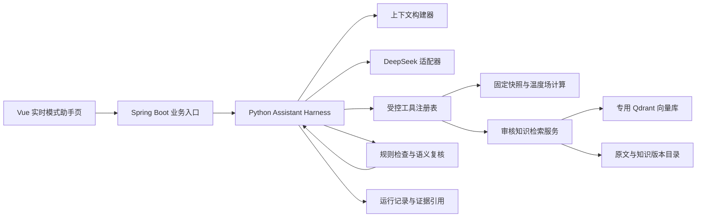

# 农业温度场智能助手 Harness 设计方案

日期：2026-10-28。状态：**设计草案，系统提示词待用户审核，尚未实现服务或完成模型评测**。

2026-10-30 更新：用户已批准方案并授权开发，首期实现已落地，见[实现状态及运行说明](10-assistant-implementation.md)。本文保留初始完整设计；已实现范围以该记录为准，真实模型与农业领域验收尚未完成。

开发分支：`codex/agri-temperature-assistant`。创建前已通过 `git ls-remote` 确认远端 `main` 与本地基线均为 `af9d49bd73886bb3f8fc82b318b8b6beffe5e615`，上次任务已推送。本文的参数是初始实验配置，不是已经验证的最优参数。

与 [页面开发交接](02-temperature-field-assistant.md)、[实时会话契约](contracts/live-sessions-v1.md) 配套使用。[系统与评估提示词](09-agri-assistant-prompts-review.md) 单独审核，审核前不接入运行时。首期重点是智能体可验证的问答闭环，再完成页面展示。

## 1. 角色、范围和系统分工

定位：专门服务设施农业温度监测与温度场分析的助手。回答棚内温度查询、空间分布、温度与作物生长的关系、适用条件明确的热害/冷害风险解释，以及有依据的管理建议。温湿度、光照、通风等仅在与温度问题相关且存在证据时参与分析。

Harness 是模型周围由程序执行的运行机制：固定分析对象、选择证据、限制工具、管理上下文、评估候选答案、终止循环、留存审计。DeepSeek 负责语言理解、提出查询计划、综合证据与表达；快照、数值计算、权限和发布门槛由服务执行。



- **Vue**：问题、上下文条、进度、取消、回答和引用卡片、查看位置。只连接 Java，不持有模型密钥，不直接执行模型提供的任意命令。
- **Java**：业务身份和工作区检查、会话/消息/运行记录、快照登记、请求去重、取消和对前端的事件流。沿用当前单机架构，首期不新增 Redis 或多实例任务队列。
- **Python**：单独的 `assistant` 模块封装运行状态机、DeepSeek 适配器、检索与受控计算工具；与已有训练/构场计算职责隔离，限制并发和计算资源。Java 与 Python 之间沿用内部凭据机制。
- **MySQL**：业务会话、运行状态、知识审核目录、版本和引用关系。现有工作区不等于完整的多租户授权；首期沿用实际身份能力，未来增加多用户时必须补齐身份、对象授权和隔离验收。
- **专用 Qdrant + 原文存储**：管理农业知识索引与原始证据。已有 MySQL 不因向量检索而整体迁移。

### 1.1 当前系统事实

| 事实 | Harness 必须执行的处理 |
| --- | --- |
| 实时源是独立 XLSX 回放，尚无设备接入 | `data_mode=replay`，显示源数据时刻和回答时刻；禁止称为此刻现场传感器直播 |
| Java 已保存实时会话及绑定模型 | 复用 `session_id`、帧号和实际模型；不能取训练工作区的当前模型冒充会话模型 |
| 稳定问答快照尚未实现 | 新建快照契约，不能宣称现有会话编号已经保证全部计算参数不变 |
| 帧/体网格请求可能补接管线数据 | 助手仅允许已经确认且可访问的帧，不调用 start/pause/next/prepare；底层读取可能计算，须核对其副作用 |
| 温度场包含模型重建/混合结果 | 区分传感器读数、重建格点、断面混合和统计；不统一称为实测 |
| 拱外与无测量带都可能没有颜色 | 复用既有有效性口径，分别解释；有外推数组元素也不能对无测量带报数 |
| 目前无通用历史检索和未来预测服务 | 首期不注册这些工具；不能凭演示文件推断历史服务已存在 |
| 当前没有通用区域统计和极值服务 | 增加后端计算，不使用色标 vmin/vmax 代替业务极值 |

## 2. DeepSeek 模型接入

先做供应商适配器，业务层不写死模型名。初始候选为官方当前列出的 `deepseek-flash`，对复杂农业解释比较 `deepseek-v4-pro`；用本项目评测集决定主模型及是否需要升级路由，不能只凭通用榜单选型。生成、向量化和重排是独立组件。

配置包括：供应商、模型标识、端点、思考模式、输出限额、超时、重试、运行总预算。密钥只从服务端环境/本地私有配置读取，不进入 Git、前端、提示词、普通日志。记录请求模型与供应商返回的模型信息；别名可能映射到更新版本，应记录能力探测结果并在模型变化时重跑回归，不能把别名当成不可变版本。

官方文档核对日为 2026-10-28：当前支持思考模式与工具调用；携带 `tools` 时对 `reasoning_content` 的回传要求与不携带工具时不同。适配器需保存完整合法消息链，遵守所选接口/版本的要求；不能用“统一删除历史思考字段”做上下文压缩。其内容不展示给用户，也不作为事实依据。官方 `strict` 工具模式仍标为 Beta，因此程序端 Schema 校验始终是必须的。来源：[模型](https://api-docs.deepseek.com/quick_start/pricing/)、[思考模式](https://api-docs.deepseek.com/guides/thinking_mode/)、[工具调用](https://api-docs.deepseek.com/guides/tool_calls/)。

## 3. 专用农业向量知识库

### 3.1 存什么，以及如何维护准确性

向量相似度只能帮助找到文本，不能保证知识正确。准确性必须通过**原始来源、审核、适用条件、版本与回答证据核验**共同建立。无法证实的内容应退出结论，不能靠更高相似度或模型自评分补足。

逻辑知识域分为：

| 知识域 | 内容 | 与现场事实的关系 |
| --- | --- | --- |
| `agri_temperature` | 作物/生育期温度需求、温度胁迫、昼夜温差、温湿耦合和设施管理机理 | 解释依据，必须检查适用条件 |
| `project_semantics` | 坐标系、有效范围、重建方法、指标含义和回放边界 | 解释系统，不产生现场数值 |
| `reviewed_local_rules` | 经审核且明确适用棚区、作物和有效期的本地管理规则 | 可参与判定，保留规则来源和版本 |

来源候选优先顺序：有效的官方标准/地方技术规程、农业科研和推广机构发布的资料、经核查的原始研究、经过专家审定的本地规程。优先级不是自动裁决；即使来源级别高，也必须满足作物、品种、生育期、地区、设施和指标定义。资料相冲突时保留分歧与适用条件，不对冲突阈值取平均。

不自动将聊天回复、论坛、自媒体、无出处表格或未经审核的模型总结入库。实时网格、传感器时间序列、聊天记忆和知识证据分别存储；尤其不能把助手上次回答作为新的农业权威证据。

### 3.2 入库流程

`原文登记 → 提取/必要时 OCR → 单位与表格核对 → 条件和知识主张标注 → 审核 → 切片 → 向量/稀疏索引 → 入库回归 → 发布版本`

- 原文保留文件摘要、出版机构、标题、发布日期、版本/有效期、页码/章节/表号、获取日期及允许的使用范围。
- 知识目录采用 `draft / reviewed / published / withdrawn`；首期审核可由受控离线流程执行，不要求先做后台管理页面。数值阈值和表格至少经过领域审核及独立数字复核，未审核文档不得被生产问答检索到。
- 按完整知识单元切分，初始目标 300–700 tokens、重叠 40–80 tokens，实际按结构调整；温度值、单位、作物、生育期、昼夜条件、持续时间、例外必须保留在同一证据单元。跨页表格合并核对，不按固定字符截断表头。
- 从正文提取阈值时保留原文与结构化字段的对应关系。摄氏/华氏、空气/叶片/根区温度、瞬时上限/持续暴露和最适/伤害阈值不可混用。
- 发布时固定 `knowledge_release_id`、嵌入模型修订、切片策略及索引配置；更换嵌入模型应重建索引并评测后切换，不能混用不兼容向量空间。
- 撤回文档时同步撤回关联主张和索引；业务目录是发布状态的真源。即使索引删除尚未完成，检索后也必须经目录复核。旧回答保留“当时使用的版本”，重新打开时标记来源已撤回，后续回答不再引用。

每块推荐字段：`chunk_id, document_id, document_hash, knowledge_release_id, title, issuer, page_or_section, table_id, crop, cultivar, stage, region, facility, day_night, temperature_target, exposure_duration, units, valid_from, valid_to, review_status, reviewer, reviewed_at, source_locator, text`。缺失字段显式为空，不由语言模型补造。授权范围存在时增加 `workspace_scope` 并由服务注入，不能由模型自行指定。

### 3.3 检索选型与链路

首选自托管专用 Qdrant。初始嵌入候选 `BAAI/bge-m3`，重排组件单独选择并在中文农业问答上比较质量与延迟；部署前核对模型修订、许可及机器资源。BGE-M3 提供稠密、稀疏和多向量检索能力；首期只启用需要的模式。依据：[模型原始说明](https://huggingface.co/BAAI/bge-m3)、[Qdrant 混合检索](https://qdrant.tech/documentation/search/hybrid-queries/)。

初始链路：

1. 根据当前问题和显式作物信息形成检索条件，不把助手旧推测扩写成事实。
2. 发布状态、有效期、权限、确定的作物等作为强过滤；未知作物/生育期不能随意填入过滤条件。允许查通用机理，但具体阈值建议应追问。
3. 稠密语义召回约 20 条、稀疏/关键词召回约 20 条，合并并以 RRF 等方式排序。
4. 重排、按来源去重与条件一致性筛选，通常提供 4–6 条证据；必要时取父段或表头补齐限定条件，仍受 token 预算约束。
5. 每条证据有稳定 ID 与准确出处；返回是否存在冲突、缺失条件及撤回状态。

召回数和证据数是起始值。不能固定“相似度超过 0.8 就可信”：不同嵌入/重排模型的分数不可直接比较，应以人工标注集校准证据可用门槛。检索不到合格证据时返回 `NO_EVIDENCE`。

## 4. 背景上下文：优先提供精准、少干扰的证据

### 4.1 固定本次分析对象

提问时由 Java 解析并登记 `snapshot_id`，绑定工作区、`session_id`、帧号、源数据时刻/时区、数据模式、数据摘要、会话实际模型/算法版本、网格档位、`monotonic`、y 范围/步长及有效性规则版本。位置同时记录请求坐标和实际吸附坐标。

模型只能引用服务端签发的快照。生成过程中最新帧继续变化，不替换本次工具输入或答案出处。服务切换会话、源数据变化或原快照无法恢复时应返回明确错误，不能自动改用新帧。用户问“最新”时在本次请求开始时解析一次，并在回答中注明数据时刻。

会话清单固定模型不代表旧帧数值天然可复现：若增量管线可能改变旧帧重算结果，应在请求开始原子捕获所需场结果或保存可重现计算产物，登记结果摘要；这一点必须用前后帧/重启回归验证。能力完成前不提供跨时刻快照保证。

### 4.2 四类上下文与可信边界

| 类型 | 内容和注入方式 |
| --- | --- |
| 固定系统策略 | 已审核角色、证据规则、输出要求；保持稳定前缀 |
| 本次业务上下文 | 快照、作物/阶段等已确认信息、区域定义、能力清单与预算；由后端生成 |
| 任务证据 | 当前工具结果与知识片段，带证据 ID、出处、时刻、单位、限制和质量状态 |
| 对话记忆 | 最近必要问答、已确认条件、未解问题与过去证据引用；属于有出处的上下文，不能升级成农业真理 |

用户新声明可以更新本次作物条件，但与既存记录冲突时应显式确认；知识中的命令性文本、文件内提示、工具返回中的“忽略规则”均属于待分析数据，不能修改系统策略、身份或权限。

### 4.3 预算示例

即使模型支持很长窗口，也先使用 **32,000 tokens 的单次有效预算**降低干扰和成本，计算约束为：

`输入消息 + 工具 Schema + 必须回传的协议字段 + 本次最大输出 <= min(32,000, 模型实测限制)`

| 部分 | 初始上限 |
| --- | ---: |
| 系统策略与必要工具定义 | 4,000 |
| 本次问题与业务快照 | 2,000 |
| 最近对话与有出处的记忆摘要 | 3,000 |
| 已重排的知识证据 | 6,000 |
| 当前数值事实和工具摘要 | 4,000 |
| 协议必需历史、思考字段及安全余量 | 5,000 |
| 本次输出预留，含供应商计入输出的推理消耗 | 8,000 |
| 合计 | 32,000 |

这是上限而非填充目标；通常单次输入远小于上限。协议字段超过预留时，应减少其他可裁剪项或到合法边界重建上下文，不可截断必须回传的字段。依据供应商 tokenizer/usage 校准中文估算，计入 JSON 和工具定义开销；输出达到长度限制时不得把半份结果当成功。

上下文构建顺序：明确问题需要哪些事实 → 加载对应工具与证据 → 去重 → 排序 → 精简 → 检查预算。优先保留当前问题、策略、快照、关键数值、适用条件与反例/冲突。先移除无关旧对话、冗余证据和已失效结果；保留引用定位，以便按 ID 回取原文。

不灌入完整三维网格、全历史、整份论文、所有工具定义或模型自身完整旧答案。大结果保存在服务端，以 `artifact_id + 统计摘要 + 必要切片` 进入上下文。检索文本可压缩，但原文阈值、单位、条件、否定、例外和出处不可改写丢失；关键数字由结构化字段校验。

长对话使用有证据指针的结构化记忆，例如 `crop=用户于消息 m12 确认；stage=未知；snapshot=...；unresolved=区域定义`。不在每次页面轮询后自动写入对话；新问题重新固定快照。稳定策略前缀可帮助 DeepSeek 前缀缓存，但缓存只影响效率，不能替代上下文筛选或事实更新。依据：[官方缓存说明](https://api-docs.deepseek.com/guides/kv_cache/)。

若需要压缩工具会话，在完整工具调用/结果对结束后建立新的合法请求，带精简事实与出处；不是在旧消息中伪造模型未生成的工具调用。适配器应验证所选 DeepSeek 接口对会话拼接的具体限制。

## 5. ReAct 执行、评估与终止

此处是 **ReAct（Reason + Act）**，与前端 React 框架无关。采用交替推理与工具行动的思路，额外增加可验证的候选答案和发布检查。[ReAct 原始论文](https://arxiv.org/abs/2210.03629)。

### 5.1 一轮的定义与计数

一轮是：`根据缺口规划 → 调用零个或多个受控工具 → 接收观察 → 形成/修订结构化候选 → 评估`。候选仅在内部保存，前端可显示“查询数据/核对农业依据/复核结论”等进度，不展示未评估的结论或完整内部推理。中间候选和最终发布使用不同状态。

| 参数 | 初始配置 | 说明 |
| --- | ---: | --- |
| `min_cycles` | 2 | 有实质结论时默认至少两轮，第一轮取证，第二轮针对具体检查项复核 |
| `max_cycles` | 6 | 默认硬上限，不以“再思考一下”无限延长 |
| `max_tool_calls` | 12 | 整个运行总数；同轮可并行只读、相互独立且同快照的工具 |
| `max_model_calls` | 16 | 包含规划/生成、语义复核、参数修复和重试；模型升级也计入 |
| `max_run_tokens` | 120,000 | 累计所有请求的输入和输出 usage；缓存命中仍计入 token 总预算 |
| `max_run_seconds` | 90 | 整体墙钟期限，先到先停；单次超时不得超过剩余时间 |
| `tool_timeout_seconds` | 10 | 初始值；慢构场不在聊天工具中暗中启动 |
| `max_transient_retries` | 1 | 每次调用最多一次临时故障重试，计入调用/时间预算；遵循 429 Retry-After |
| `no_progress_cycles` | 2 | 连续两轮没有新增有效证据或解决检查项则结束 |

最低轮数约束适用于正常结论路径；追问、域外回答、无可用数据、用户取消、硬故障及预算耗尽可以提前退出，记录原因，不为凑轮数执行无意义工具。最大轮数与总预算优先，允许返回有界的部分结果。尚未进入的模型调用按最坏可用 token/费用预留，避免最后一次请求透支；可另设按模型价格计算的费用上限。

第二轮不能只复述第一轮。纯数值查询核对快照、坐标吸附、有效区、单位和舍入；农业建议核对作物/阶段/暴露条件、原文阈值与证据是否真正支持该建议。证据已充分时不必强行再次查库。最低两轮不等于工具必须调用两次。

### 5.2 运行状态与算法

`created → snapshot_bound → running → evaluating → answered / partial / needs_clarification / no_data / unsupported / budget_exhausted / failed / cancelled`

每轮保留 `cycle_id, candidate_version, evidence_ids, unresolved_checks, evaluation, next_action`，不用保存模型完整思维链作为业务决策记录。`need_more_evidence` 要指向具体缺口与下一步工具，不接受空泛的“再核实一次”。

```text
校验请求、去重、绑定快照；必要条件缺失则追问
for cycle in 1..max_cycles:
    检查取消、期限、工具/模型/token/费用预算
    按当前问题与 unresolved_checks 构建有限上下文
    让模型产生经 Schema 校验的工具请求或候选
    服务端执行允许的工具；核验快照和结果有效性
    形成带 claim→evidence 映射的候选
    运行硬规则检查与必要的语义复核
    若发现不可修复的数据缺失/条件缺失：结束或追问
    若通过全部适用检查且 cycle >= min_cycles：发布
    若缺少新证据且连续两轮无进展：停止
    根据可修复检查项选择下一步；禁止同参数无变化重复调用
到达上限：仅发布已通过检查的事实及其范围，说明未解决内容
```

去重键至少包含工具名、规范化参数、快照和知识版本。相同调用已成功且版本未变时复用结果；只有明确临时故障才允许有限重试。错误参数修复不是网络重试，也受总调用数限制。用户取消后终止后续步骤，迟到结果不能覆盖已取消消息。

### 5.3 如何评估每一轮

**第一层：程序硬规则，任何关键失败都禁止发布对应主张。**

- Schema、必填参数、工具白名单、对象授权与调用限额。
- 快照/会话/帧/实际模型/计算参数一致；数据不可用时不能用旧缓存冒充新数据。
- 温度和统计值必须出自工具事实；单位换算、差值、聚合由受控计算完成。展示舍入允许差异，判定用未舍入值；容差按各工具数值契约定义。
- 温度主张绑定 `fact_id`；农业阈值绑定已发布知识单元及版本；引用 ID 必须存在、可访问且未撤回。不能只检查“有引用标记”。
- 请求坐标和实际吸附坐标都可追溯；`outside/unmeasured/missing` 不生成数值结论。
- 区域统计声明计算域、采样/权重和有效覆盖；不同均值定义不可互换。
- 当前无逐格置信区间时不得生成；验证 RMSE 不转成当前帧现场误差。
- 条件性阈值缺作物/生育期等必要条件时禁止直接判为适宜或热害；相关性不能写成已证明的原因。

**第二层：语义复核。** 用独立的评估调用对照用户问题、结构化主张、工具事实和证据原文，检查适用性、蕴含关系、冲突、事实与假设的区分、遗漏及建议的可执行条件。可以使用同供应商模型但承认同源偏差；它不是独立专家。输出 `pass/fail/unknown/not_applicable + 问题位置 + 所需修复`，不输出一个主观“置信度 95%”。必要条件为 `unknown` 时不能当通过。

初始发布规则：硬规则全部通过、适用语义检查全部通过、问题已回答或清楚限定部分回答、没有关键未解决冲突，并满足轮数和预算。不存在允许高“表达分”抵消错误数值的加权总分。农业效果最终由人工评测确认，模型互评只是辅助。

### 5.4 示例

用户问“这个位置对番茄苗会不会太热？”：

1. 固定本次快照，读该点的吸附坐标、重建温度、有效性和数据时刻；核对“苗”的阶段能否确定，查审核知识。若阶段/温度对象仍关键不明，先追问。
2. 第一轮产生事实与条件性判断，评估发现知识阈值要求持续暴露而只有单帧数据，标记缺口。
3. 第二轮核对原文条件和现有能力。首期没有合格时序工具时，不编造持续时长，不反复检索企图补出现场历史；回答“该帧温度及出处可确认，持续热胁迫不能据单帧判定”，给出需要补充的记录与观察建议。

## 6. 工具能力、约束与评测

### 6.1 首期工具清单

| 工具草案 | 目的 | 当前基础/新增工作 | 重点验收 |
| --- | --- | --- | --- |
| `get_analysis_context` | 返回固定快照、实际模型、数据模式和有效性规则 | 复用实时会话，新增快照与完整元信息 | 不能切到新帧/新会话；恢复及重启后仍可追溯 |
| `get_temperature_point` | 查询实测点或最近有效格点，区分来源 | 现有场数据与前端判定口径可复用，新增服务端统一查询 | 越界、拱外、无测量带、吸附坐标、单位及空值 |
| `get_field_summary` | 当前域的概览、有效覆盖和计算口径 | 核对现有摘要，缺口在后端补齐 | 与监测页同口径；不是平均所有传感器就叫体积均温 |
| `compare_regions` | 在显式区域内比较温度 | 新增受控区域统计 | 边界、权重、有效体积/采样点数、缺失处理；单帧不能计算时间暴露 |
| `find_temperature_extrema` | 查有效域内的最高/最低位置 | 新增后端极值及并列点处理 | 极值在有效域；返回位置与采样分辨率；不把色标当极值 |
| `get_model_explanation` | 解释当前会话模型与验证含义 | 复用模型库/会话绑定，新增稳定摘要 | 不泄露内部文件或凭据，不用工作区另一模型冒充 |
| `search_agri_knowledge` | 查已审核知识并返回出处与条件 | 新增专用库、混合检索、重排 | 召回、条件匹配、撤回过滤、注入防护和无证据处理 |
| `get_knowledge_evidence` | 按 ID 取原段/表头/版本，复核引用 | 新增 | 逐字核验数字单位及表格行列，防止断章取义 |
| `calculate_temperature_metric` | 单位换算、差值等白名单计算 | 新增固定计算函数 | 输入单位/维度、有限数、边界；禁止执行任意表达式/Python/SQL |
| `build_view_action` | 构建查看位置/断面的类型化动作 | 复用页面路由，新增上下文联动协议 | 合法目标、同一快照、不会静默切换播放状态；不可用则说明 |

上下文获取和 Schema/有效性校验可由 harness 强制执行，不必让模型决定是否执行。按问题只开放相关工具；管理操作不进入问答工具注册表。

后续工具：历史趋势、阈值持续暴露、气象关联、外部天气、报告导出。每项必须在数据服务和验证完成后注册；外部天气不代表棚内实测，未来预测需要独立可评估模型。联网农业资料只作为“待审核来源发现”，首期不允许直接作为栽培阈值发布。

首期不注册播放控制、模型切换/训练、数据删除、任意数据库查询、任意代码执行和设备控制。未来设备控制必须单独设计授权、互锁、回执和人工确认，不把聊天建议自动当指令。

### 6.2 统一工具契约

输入采用 JSON Schema，限定枚举、长度、坐标/时间/区域大小和 `additionalProperties=false`；快照和工作区由服务端绑定，不能信任模型传来的身份。坐标吸附需使用共享规则，并明确请求点与返回点；对超出允许范围的点不静默夹紧。

结果示例结构（字段是设计草案，不是现有接口）：

```json
{
  "tool_call_id": "...",
  "status": "ok|no_data|invalid|unsupported|conflict|timeout",
  "snapshot_id": "...",
  "evidence_ids": ["F1"],
  "facts": [],
  "provenance": {},
  "quality": {},
  "limitations": [],
  "artifact_id": null
}
```

数值事实进一步带 `fact_id, value, unit, origin, requested_position, actual_position, validity, statistic_definition`；出处含源时间、会话模型、数据摘要与算法版本。`no_data` 不返回虚构默认数值；超时不自动复用另一个快照。结果大小有限额，全文或大网格通过受控 ID 回取。工具输出视为数据，即使来自可信服务也不把其文本作为系统指令执行。

## 7. 页面与接口交付方案

页面沿用实时模式深蓝外壳与导航，注册 `/assistant` 时同步修复实时工作区识别。上下文条显示棚区/位置、作物及阶段（未知就显示未知）、源数据时刻、回放状态、实际模型。主体为对话和可展开的数值/知识证据，输入区固定可见。

回答由“结论 → 数值卡片 → 农业解释及适用条件 → 建议/不确定性 → 引用与查看位置”组成，按问题简化。展示的是可追溯依据与简短方法说明，不是模型完整内部推理。工具执行阶段可流式发进度；未经最终检查的答案只在服务内部形成。

建议业务 API 草案：

- `POST /api/assistant/conversations`：创建会话。
- `POST /api/assistant/conversations/{id}/runs`：提交问题与快照选择，使用 `Idempotency-Key` 去重。
- `GET /api/assistant/runs/{id}/events`：SSE 进度与经过发布检查的最终答案。
- `POST /api/assistant/runs/{id}/cancel`：取消；校验对象归属，重复取消幂等。
- `GET /api/assistant/runs/{id}`：断线后查询权威状态；事件带递增 `event_id` 供去重/续传。

最终答案结构至少有 `status, answer, claims, facts, citations, assumptions, missing_conditions, actions, snapshot_id, prompt_version, knowledge_release_id, finish_reason`。每个事实型/农业判断主张都映射到事实或证据 ID；不能让“正文编一个数、结构化卡片是另一个数”。前端只渲染经过校验的引用链接与动作类型。

运行记录保存问题、结构化候选、工具摘要与出处、检查结果、循环/调用计数、耗时与 usage；按证据版本可回放决策过程。提示词、知识版本、工具契约、模型能力配置均版本化。业务记录不存完整模型思维链或密钥；协议必需的临时消息链与业务审计分开管理，遵循明确保留期。

## 8. 评测集与上线门槛

先建立人工标注的约 150 条问题起步集，包含至少以下类别：数值/坐标/有效性 35，空间统计 20，农业知识与适用条件 35，缺证据/冲突/应追问 20，多轮与快照一致性 20，注入/越权/取消/故障 20。分开发调参与冻结验收集，按模板族与来源文档划分避免同义改写泄漏；发布前补充未见过的问题。数值真值从固定夹具和独立计算获得，农业真值由领域审核者按原文标注。

| 层次 | 指标 | 初始验收目标（待实测校准） |
| --- | --- | --- |
| 知识目录 | 发布资料有原文、出处、审核与适用条件 | 100% |
| 检索 | 有证据问题的 Recall@10 | ≥90%，同时报告重排后上下文的证据覆盖率 |
| 工具 | 合法调用任务成功率 | ≥95%；越界/无测量带误报数在验收集中为 0 |
| 数值 | 单位、位置、同快照、结果一致 | 在规定容差与展示舍入后 100% |
| 引用 | ID 有效且能定位原文 | 100%；是否真正支持主张由专家抽检，目标 ≥95% |
| 农业适用性 | 条件和结论正确 | 人工审核目标 ≥95%；重大误导案例为 0 |
| 缺失处理 | 应追问/应保留判断时正确停止 | ≥95% |
| 循环 | 轮数/工具/时间/token 上限得到执行 | 100%；上限耗尽率、无进展率单独报告 |
| 防护 | 注入、未授权对象、取消后的写回被拦截 | 指定攻击/并发案例全部通过 |
| 体验 | 完成率、首个进度/最终答案延迟、成本 | 分问题类型报告 P50/P95；90 秒上限不是性能验收成绩 |

测试集全部通过不等于现实问题永远正确；报告样本量、分类型结果和失败例。一次严重的数值来源错误、知识条件错用或越权不能被平均分掩盖。评测模型不能替代人工农业审核。

比较基线：普通 DeepSeek 对话、固定 RAG 单次回答、完整 Harness；再做移除重排/移除第二轮复核的对照，确认额外延迟和费用带来质量收益。最低轮数、最高轮数、检索数量和上下文大小按这组实验调整，不能为了展示“智能体”而保留没有收益的循环。

必要工程验证包括：工具契约与数值边界、知识撤回、证据注入、多轮快照切换、同问题并发/去重、SSE 断线、取消、服务重启、DeepSeek 限流与输出截断、预算终止。页面验证包含深色外壳、直达刷新、长对话滚动、引用展开和位置联动。

## 9. 实施顺序与审核点

1. **本轮设计**：形成本文和独立提示词草案，明确当前能力和待新增能力；不接外部收费服务、不改变实时播放、不导入未审核农业知识。
2. **提示词与知识范围审核**：用户审核角色、农业建议范围、回答格式和评估规则；首批作物/生育期及可用权威资料由项目方确认。缺少这些材料不妨碍先做工具/运行框架，但阻止声称农业阈值库已经可靠上线。
3. **工具事实闭环**：实现固定快照、点温/概览、统一有效性和结构化事实，先以确定性夹具验证。
4. **知识闭环**：建立专用库、原文/审核目录、版本化检索和引用复核，导入少量经过审核的真实知识，而非大量未经核验文本。
5. **Harness 闭环**：接 DeepSeek、状态机、上下文预算、双层评估、取消、去重、终止和审计，跑离线评测。
6. **页面与联调**：开放导航、真实问答、证据卡片和场景联动；通过工具、领域和页面验收后再扩展区域统计/历史能力。

审核重点：系统提示词是否符合农业助手定位；农业建议与不确定性表达；默认 2–6 轮及例外；首期工具范围；首批知识来源与审核责任。后续代码实现应同步更新本文的状态，不把设计参数写成已取得的评测结果。
