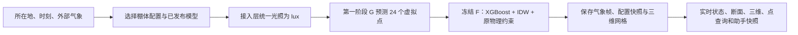

# 实时监测后端：外部气象输入

更新：2026-11-05。前端源码和页面本轮保持不变；Java 业务版本仍为 0.6.0。

## 统一的数据通路

实时监测与气象构场现在共用 `WeatherService.submit`、气象模型部署和 `weather_frame`，不再维护两个在线模型流程：



`POST /api/live/weather` 和原 `POST /api/user/weather` 共用相同校验与持久化逻辑。两入口交替提交也属于同一账号/档案/地区的历史流，可共同积累连续一小时的气象历史。用户不提交棚内测点，也不选择任意模型路径或编号。

```json
{
  "location": {"province_code":"220000","city_code":"220600","district_code":"220621"},
  "timestamp":"2026-11-05T12:00:00+08:00",
  "bg_temp":25.0,
  "bg_light":1000.0
}
```

`full` 部署另须 `bg_rh`，单位为 %；`two` 部署由 G 估计第二阶段所需背景湿度。自 2026-11-08 起，光照省略单位时按训练数据的 lux 保持原值，显式传 `bg_light_unit: "W/m²"` 时由 Java 接入层用服务端可配置的日光光效估算 lux，保留原始值与换算记录，详见 [气象接入层光照换算](32-weather-light-conversion.md)。尚未自动请求天气提供商。时间必须带时区。多余的 `sensor_temps`、`indoor_temp` 等输入被 422 拒绝。

## 接口及兼容边界

`/api/live/**` 允许 USER、ADMIN，均按当前账号隔离；不通过全局训练工作区或旧文件回放取场。未登录为 401。

| 接口 | 当前行为 |
| --- | --- |
| `GET /api/live/regions` | 同一份吉林省地区字典 |
| `POST /api/live/match` | 可选 `{greenhouse_id}`，单份启用配置自动选用，多份明确选择；地区只表示气象来源 |
| `POST /api/live/weather` | 提交外部气象并构场；返回原气象帧和该帧的 `live` 视图 |
| `GET /api/live/status` | 当前账号最近完成保存的气象结果；无数据时 idle，不读取默认文件、不训练 |
| `POST /api/live/prepare` | 有气象请求体时构场；无请求体仅复用已保存结果，无结果时 422 |
| `POST /api/live/sessions` | 必须提供外部气象请求体，创建/复用对应气象观测；不创建文件回放会话 |
| `GET /api/live/frame/0` | 已保存网格的三个源断面及环境信息，保留旧响应形状 |
| `GET /api/live/volume/0` | 已保存的 37 片三维网格；`y_step=3` 抽取 7 片用于原均温曲线 |
| `GET /api/live/point/0?x=...&y=...&z=...` | 对同一份保存网格三线性插值，保留拱外、无测量带和缺失格限制 |
| `POST /api/live/start/pause/next` | 返回 409 并解释外部气象驱动方式；不会制造新天气、按文件推进或恢复 24 路输入 |
| `POST /api/assistant/snapshots` | 管理员绑定自己的当前气象结果，不再取全局文件回放 |

当前实时视图只展示最近一条结果，因此 `cursor=0`、`total=1`、`running=false`，无结果时 `total=0`。每份结果 UUID 作为 `session_id`；新气象保存后 UUID 改变，原前端的轮询可识别新场。状态提供 `input_mode=external_weather`、`update_mode=on_weather_submission`、时区与来源说明。重试旧气象返回原记录，不把它改写为新记录；当前结果仍由最近保存记录确定。

2026-11-06 起，状态及网格响应的 `live` 对象附带 `weather: {bg_temp,bg_rh,bg_light}`，使用已保存的外部输入；未提交湿度时 `bg_rh=null`，不使用 G 估计的背景湿度代替。实时概览与省市地区的展示约定见 [气象概览](28-live-weather-overview.md)。

查询支持 `session_id`，准备支持 `X-TField-Expected-Session`（空状态为 `none`）；与当前账号最新结果不符时 409，不能借此读取另一账号的记录。点查询支持 `expected_ref`；观测或视图参数不符时 409。固定网格视图只允许 `standard`、`monotonic=true`、0–18 m 范围、0.5–6 m 且为 0.5 m 整数倍的切片间隔；不接受读取时偷偷换模型、取消物理约束或插造更细网格。无效设置返回 422。

历史仍通过 `/api/user/greenhouses/{id}/frames` 与其 `field` 接口获取。修改档案或停用模型不重算旧结果。无已发布且尺寸兼容的地区档案时，必须先由管理员完成配置，不能回退读取原传感器文件。

## 来源和时间

三维源平面、断面和点查询始终 `measured=false`，预测点放在 `frame.predicted_sensor_temps`；旧的 `frame.sensor_temps` 保留 24 个 null，避免旧页面将模型预测值当成传感器实测。第一阶段推断和冻结 F 均只在提交时执行；状态、断面、三维和点查询只读保存结果。

兼容视图使用 `Asia/Shanghai` 的带时区时间，使旧页面只截取时间文本时仍显示北京时间；原气象记录和 provenance 保持 UTC。助手快照的时刻、网格和事实使用同一观测，明确标注模型推算，不能声称为文件回放或现场实测。

## 文件回放与前端后续

原 V4 的 XLSX 回放代码和会话数据保留在管理员专用 `/api/replay/**`，方法与旧回放相同；Python 内部回放协议仍保留以便恢复历史记录。普通用户访问回放接口为 403，公开 `/api/live` 不再通过通用代理回落到旧计算源。

本轮后端任务没有编辑前端源码、角色导航或表单。兼容原 `LiveView` 组件的旧“准备/开始/暂停/下一帧”请求时，后端按上表提示；它们不会自动变成新的气象输入控件。现有用户气象工作台仍可经原 `/api/user/weather` 提交，同样更新自己的实时后端状态。验收期间检测到工作区有并行的前端登录/导航调整，这些改动被保留，没有为了本任务回退；本轮并不声明工作区前端哈希整体未变。

## 代码与验证

- `WeatherLiveService`：账号当前气象观测、旧响应适配、观测版本保护。
- `ReplayController` + 原 `LiveService`：独立管理员文件回放。
- `api/weather_views.py`：保存网格的只读断面、抽片、点查询、气象助手快照。
- `internal_weather.py`：带内部凭据的视图协议，`views_version=1` 纳入统一健康检查。
- 无新数据表或迁移；原账号、模型、回放记录保留。测试助手数据通过绝对路径 `TFIELD_ASSISTANT_STATE_ROOT` 隔离；正式默认路径保持原 `.local/assistant`。

具体验收、日志及本机更新情况见 [本轮记录](../reports/live-weather-backend-20261105.md)。
