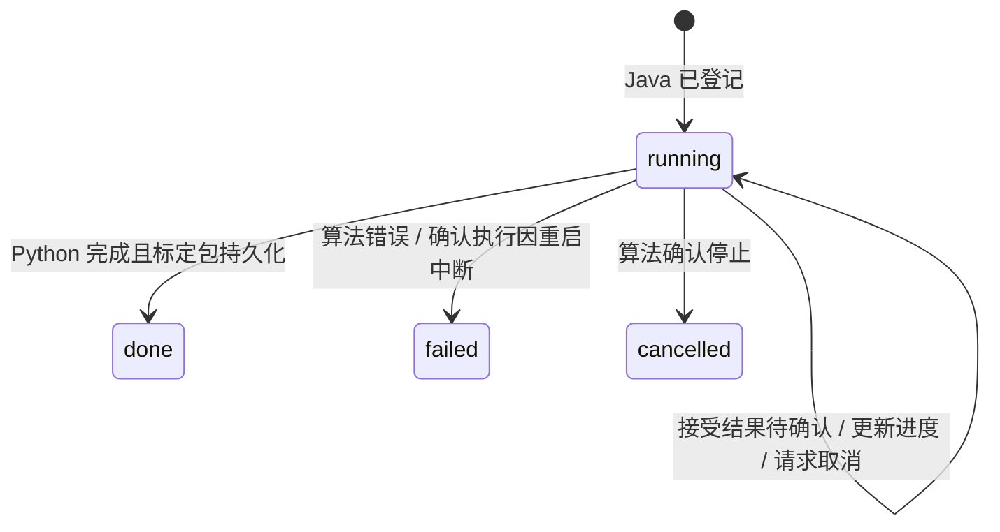

# 训练任务与模型库协议 v1

适用版本：Java 业务服务 0.3.0 起，Python 内部训练协议版本 1。当前业务版本 0.5.0，前端继续使用原训练和模型库页面。

## 1. 当前分工

| 内容 | Java | Python |
| --- | --- | --- |
| 训练登记 | 分配 UUID、保存数据集和参数引用、查询与核对状态、记录取消意图 | 同编号接收一次执行，实际训练、报告进度、协作停止 |
| 暂存结果 | 记录当前未保存结果引用 | 持久化训练执行元数据、标定包和待保存成品 |
| 模型库 | `model` 表唯一写入方；提供只读内部记录与原始产物接口 | 兼容性判断、列表和详情展示结构、解释标定包与模型字节 |
| 当前选择 | `workspace_context.model_id`、`latest_job_id`、`result_job_id` | 每次请求按明确引用计算，不依赖自身全局模型选择 |

原模型表的 ID、JSON 和二进制内容保持不变。V2 建立 `training_job`、扩展工作区，空库使用原模型表结构；缺少 artifact 列的老表补列。工作区首次接管原 `is_current=1` 中 ID 最大的模型，与旧选择规则一致。

默认 `TFIELD_MODEL_STORE_MODE=java`。Python 通过 Java 内部接口读取模型，原模型保存、切换和数据库连接写入口被禁用。`legacy` 仅用于停用 Java 后的旧模式回退，不可与 Java 同时写同一模型库。

## 2. 对前端的兼容接口

| 方法与地址 | 约定 |
| --- | --- |
| `POST /api/calibration/jobs` | 202，返回原任务摘要；可选 `Idempotency-Key`，1–128 位字母、数字或 `._:-` |
| `GET /api/calibration/jobs/{id}` | 从 Java 任务记录查询，并尝试核对运行中任务；记录可跨 Java 重启读取 |
| `DELETE /api/calibration/jobs/{id}` | 持久化取消意图，向 Python 请求停止；返回已确认的当前状态 |
| `GET /api/calibration` | 原标定结构，`job` 使用 Java 对当前数据集保存的最近任务摘要 |
| `GET /api/models`、`GET /api/models/{id}` | 保留原列表、详情及兼容性规则；Python 展示层从 Java 读取记录 |
| `POST /api/models` | 原 JSON `{name}`，保存已完成、当前有效的未保存结果，201 返回原模型行 |
| `POST /api/models/{id}/current` | Java 事务更新当前项，返回 `{id,is_current:true}`；解除当前未保存结果的优先使用 |

摘要字段仍为 `id`、`state`、`progress`、`elapsed_s`、`error`、`created_at`。任务 ID 是不透明字符串，新任务使用 UUID；不要按旧 12 位长度解析。训练已在运行时返回 409，正文带 `detail` 与 `job_id`。相同幂等键在同一数据集下返回原任务，不重新执行；键区分大小写，换数据集复用该键返回 409。没有幂等键时，“已完成后再次训练”表示新任务。

前端训练组合式为每次提交生成键；响应不确定的网络或服务错误保留该键，同一应用中的手动重试（包括切页返回后）继续同一次提交，收到明确响应后才生成下一次编号。刷新后通过标定摘要接管已有任务，不自动再提交。只有携带 `job_id` 的运行冲突才接管原任务，其他 409 正常展示错误。

### 前端跨页面状态（2026-10-22）

- `App.vue` 提供按需创建的训练工作区，`useTrainingWorkspace.ts` 持有优选轮询、提交状态、面板参数、诊断请求与结果、保存名称和保存状态。页面卸载只销毁图表，不销毁工作区。
- 切页后优选继续查询原任务；任务完成时读取新标定包。返回训练页只读取最新上下文并恢复展示，不自动提交优选或诊断请求。
- 普通重读同一标定包、保存后来源从 `unsaved` 变为 `library`，均保留手调参数与匹配的诊断。包身份或后端参数改变时重新填充面板；诊断按包时间、数据指纹、特征签名和实际参数核对，旧结果不作为新参数成绩展示。
- 导入数据集使工作区整体失效，停止旧轮询；旧请求的晚到响应不能恢复旧任务。应用销毁也释放工作区。状态在同一应用内跨路由保留，不使用 `KeepAlive` 保留图表和三维实例。
- “开始训练”仍调用 `POST /api/calibration/diagnostics`，其在飞请求与结果由工作区持有。浏览器刷新或关闭后的诊断恢复不在本次范围内；优选任务仍可按后端摘要恢复。

## 3. 任务状态与恢复

- `running` 包含等待 Python 确认接受的短暂阶段，进度文字说明当前情况。
- Java 每约 2 秒核对运行中任务；控制请求超时为 10 秒。断联时保留原任务和取消意图，显示等待核对，不直接宣布失败或取消。
- 内部提交使用同一任务 ID 重试。Python 在启动执行之前写入接受记录；同 ID、同数据和参数只返回同一执行。
- Java 重启后继续核对已有运行任务。Python 重启时将磁盘上未结束的执行标为 failed，不自动重新训练；已完成标定包仍可读取。
- 未知执行若来自另一个 Python 启动实例，Java 明确记录中断。计算服务暂不可用与已确认重启中断是不同状态。
- Java 数据库的唯一运行槽、工作区锁与 Python 执行锁共同维持一次一个任务。首轮仍限一个 Java 实例和一个 Python 实例。

任务保存提交时的数据集 UUID、数据内容摘要所对应的版本，以及 Python 配置快照与摘要。配置包括特征组、留出切点、随机种子、试验次数、搜索空间、算法版本与核心源码摘要。Python 按已记录参数执行；更换计算代码后需重启，旧结果的导出应使用匹配的计算版本。

## 4. 暂存与模型保存

默认目录：`backend/configs/training-jobs/<job_id>/`，由 Python 管理，可用绝对路径 `TFIELD_TRAINING_ROOT` 覆盖。

| 文件 | 内容 |
| --- | --- |
| `state.json` | 接受记录、进度、终态、数据和配置引用、结果摘要 |
| `bundle.json` | 训练完成后的标定包；done 之前写入 |
| `artifact.bin` | 首次保存时生成的模型成品；生成后可重复获取 |
| `search/` | 本次训练的参数曲面等计算输出 |

关键文件先写临时文件并同步，再原子替换。取消或失败不会登记模型。暂存文件不等于模型库记录，只有用户点击保存才入库；目前没有自动过期清理。

保存流程：确认任务和当前数据一致 → Python 校验并导出标定包、原始成品及摘要 → Java 校验 SHA-256 → 同一事务插入模型、写任务的 `saved_model_id`、更新工作区及兼容 `is_current` 标记。Java 不反序列化 Python pickle。

同一任务最多关联一个模型。重复保存同一已保存任务、同一名字且当前项未改变时返回原 ID，不再插入；改名字重试返回冲突。若用户已切换模型或开始下一次训练，则按当前上下文决定能否保存，不将旧结果重新设为当前。

训练结果优先级由 Java 的 `result_job_id` 明确指定；切换模型会退役该未保存结果。暂存文件仍保留供核对，当前没有通过前端重新选用已退役结果的功能。模型允许跨数据集借用的原业务规则保留；不兼容成品或缺成品的旧模型仍由 Python 按原规则处理。

## 5. 内部接口与计算上下文

所有内部接口需共用凭据 `X-TField-Internal-Key`，不要通过浏览器调用。

| Python 地址（前缀 `/internal/v1/training`） | 用途 |
| --- | --- |
| `GET /info` | 协议、进程启动编号、模型管理模式、参数快照和配置摘要 |
| `POST /jobs/{UUID}` | `{config_sha256,created_at}`，配合明确数据上下文接收执行 |
| `GET /jobs/{UUID}` | 状态、启动编号、数据集和参数摘要 |
| `POST /jobs/{UUID}/cancel` | 幂等请求停止；终态返回原状态 |
| `POST /jobs/{UUID}/export` | 返回标定包文本、Base64 原始成品、摘要及入库元数据 |

Java 只读模型接口前缀 `/internal/v1/model-store`：`GET /selection`、`GET /models`、`GET /models/{id}`、`GET /models/{id}/bundle`、`GET /models/{id}/artifact`。缺成品返回 204；不存在的模型返回 404。列表不携带大产物。

Java 为计算请求补充 `X-TField-Model-Id` 和 `X-TField-Result-Id`，空引用使用 `none`；Python 通过独立上下文绑定。数据相关请求同时使用 [数据集协议](dataset-workspace-v1.md)。Java 内部读接口不占计算协调锁，避免 Python 读取模型时与外层请求互相等待。

阶段 3 的实时 prepare 使用请求开始时的模型引用。0.4.0 起已升级为会话级固定模型、源副本与游标恢复；切换模型仍不自动重建已有会话，详见 [实时会话协议](live-sessions-v1.md)。

## 6. 配置、备份与验收边界

Python 新配置：`TFIELD_BUSINESS_URL` 默认 `http://127.0.0.1:8080`，`TFIELD_MODEL_STORE_MODE` 默认 `java`，`TFIELD_TRAINING_ROOT` 默认项目内暂存目录。Java 保留原 MySQL 和 Python 地址配置。双方使用同一内部凭据；Python 启动不需要先读取模型，Java 迁移完成后即可互相调用。

基线工具同时备份 model、dataset_record、training_job、live_session、live_operation、workspace_context 与 Flyway 历史。恢复到新空库时先导入 `model-store.sql`，再导入 `dataset-workspace-store.sql`；生成列由数据库恢复，不能作为 INSERT 的普通列。然后恢复数据版本、训练暂存与实时会话目录，再启动服务。外置存储根需另行备份。运行中的线程不能从备份继续，应先取消或结束执行，暂停实时并等操作确认后做一致性备份。

阶段 3 完成编译、建表与旧模型对照；阶段 5 已在独立环境执行完整 40 次真实参数搜索、结果跨重启保存、重复保存、取消、互斥、计算失联和运行中重启失败，并从备份向空库恢复。实际范围与未覆盖的故障窗口见 [联调记录](../06-migration-acceptance-20261019.md)。

实时会话已在阶段 4 接入，阶段 5 已完成单机统一部署及核心流程联调。后续运维与更多故障窗口按实际环境继续安排。
