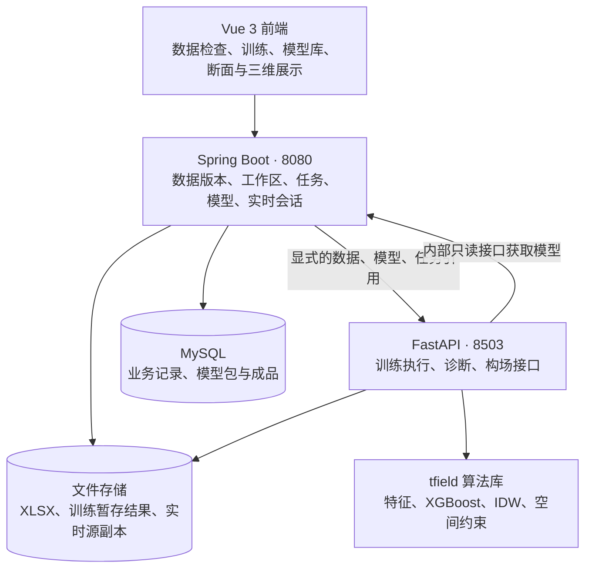

# 设施棚式监测系统：架构与温度场模型训练汇报

整理日期：2026-11-02。依据当前工作区源码、已有标定包和项目验收记录整理。本次未重新训练模型、未重新运行系统验收。文中的实验指标是已有结果，不代表当前工作区最新一次训练。

## 1. 汇报主线与建议用时

建议用 8—10 分钟，按“要解决什么问题 → 系统怎样实现 → 模型怎样训练 → 怎样验证 → 已有结论与下一步”展开。

| 页次 | 主题 | 建议讲解内容 |
| --- | --- | --- |
| 1 | 研究目标 | 利用有限测点与同期气象，重建棚内空间温度分布 |
| 2 | 系统架构 | Vue 展示、Spring Boot 管业务、FastAPI/tfield 做训练计算 |
| 3 | 数据与特征 | 3 个断面、24 个测点、同期气象、13 维特征 |
| 4 | 混合模型 | XGBoost 趋势 + 各向异性 IDW 残差修正 |
| 5 | 参数训练与选择 | 空间留出、三阶段交替搜索、最终部署拟合 |
| 6 | 方法可行性的证据 | 留出点误差、分位置结果、诊断与工程验收 |
| 7 | 连续构场与实时使用 | 断面混合、可选竖直约束、离线趋势冻结及同帧残差更新 |
| 8 | 结论与待补实验 | 初步空间重建可行；补消融与严格时空独立测试 |

## 2. 可以直接使用的开场

我们开发的是一个面向设施棚式环境的温度场重建与可视化系统。传感器只能测到有限位置的温度，我们希望结合测点坐标、同一时刻的背景气象和其他已知测点信息，估计未布设传感器位置的温度，形成可查询的断面和三维温度场。

系统采用 Vue、Spring Boot 与 FastAPI 分工协作。模型方法采用 XGBoost 学习温度趋势，再用各向异性反距离加权修正空间残差。我们通过空间测点留出验证其重建能力，并用完整训练、保存和恢复链路验证工程可用性。

本项目当前主要研究同一时刻的空间重建，不将文件回放称为真实设备接入，也不把它称为未来温度预测。智能助手是另一个应用模块，本次介绍的训练对象是温度场模型，并未训练通用大语言模型。

## 3. 系统架构

前端负责交互和展示；ECharts 展示曲线与诊断，Three.js 展示三维场。温度、均温与有效区域等业务计算由后端统一提供。

Spring Boot 负责业务可信性：记录本次训练使用哪一份数据和配置、任务是否完成、保存的是哪个模型，以及实时会话恢复到哪里。

FastAPI 和 tfield 负责数值计算：读取数据、构造特征、搜索参数、拟合模型、计算残差、生成温度场。

MySQL 保存数据集元信息、工作区、训练任务、模型、实时会话和操作记录；原始工作簿、未保存训练结果与实时副本保存在磁盘。计算对象和缓存仍在 Python 内存中。

一次训练：前端提交 → Java 校验数据、登记任务与配置 → Python 后台搜索与验证 → Java 核对进度 → 用户保存 → Python 导出包与成品 → Java 校验摘要并事务入库。

解释架构价值时，应强调数据、模型、任务身份可追踪，以及业务管理与科学计算各自集中实现。增加 Java 本身不提高算法精度。

## 4. 数据与特征

当前样例有 3 个棚位断面，y 分别为 3、9、15 m；每个断面布置 8 个测点，共 24 个。完整样例有 1308 个时刻，采样间隔 300 秒；输入含温度、湿度、背景气象和质量标记。

默认留出时间切点是 2026-07-27 12:00，完整样例切为 1164 个训练时刻和 144 个实时回放帧。该留出是部署演示用的时间边界，不等于已经完成严格的未来时段评分。

训练时把宽表整理为“测点 × 时刻”的长表。1164 × 24 = 27936 条样本，但这些样本存在时空相关性，不能称为 27936 个完全独立观测。

| 特征组 | 特征 | 数量 |
| --- | --- | ---: |
| 空间坐标 | x、y、z | 3 |
| 高度基函数 | z²、z³ | 2 |
| 背景气象与时间 | 背景温度、背景湿度、背景光照、小时、日内小时时间 | 5 |
| 交互 | 背景温度×高度、光照×高度、背景温度×光照 | 3 |

共 13 维特征，监督目标为棚内温度。目标位置的测点湿度未被用作趋势输入，因为在未布点位置它通常也是未知量。训练与查询共用特征定义，避免列顺序和含义漂移。

数据已进行时间对齐，不能把所有单元格称为未经处理的传感器实测。

## 5. 模型方法

记位置 s=(x,y,z)，时刻 t，特征为 φ(s,t)，模型为：

\[
\widehat T(s,t)=f_\theta(\phi(s,t))+\sum_{i\in S_t}w_i(s)[T_i(t)-f_\theta(\phi(s_i,t))].
\]

第一项是 XGBoost 趋势预测；括号内是已知源测点在该时刻的残差；第二项对这些残差进行空间加权。

各向异性距离与权重为：

\[
d_i(s)=\sqrt{((x-x_i)/l_x)^2+((y-y_i)/l_y)^2+((z-z_i)/l_z)^2},\qquad
w_i(s)=\frac{d_i(s)^{-p}}{\sum_j d_j(s)^{-p}}.
\]

重合位置在实现中使用距离下限处理。cross_shed 决定残差是否跨棚取源；关闭时使用目标最近棚的源点。

这样组合的动机是：趋势模型表达气象、时间和空间之间的非线性关系；残差修正利用同期已知测点补充局部空间偏差。各向异性长度尺度允许不同方向有不同影响范围。这是可检验的建模假设，其相对优势仍需要消融对照验证。

完整方法需要同一时刻的源测点温度。只有气象、完全没有同期棚内观测时，不能声称仍运行同一套完整重建方法。

## 6. 模型怎样训练和验证

### 6.1 空间留出是关键

当前有 8 种断面内位置。每一折留出某一种位置在 3 个棚的全部时间记录，因此每折留出 3 个传感器，使用其余 21 个传感器训练。

例如验证 x=1.05、z=0.7 这一位置时，三个棚该位置的温度都不参与该折趋势拟合，也不能作为该折 IDW 源点。重建完成后，再与留出位置的温度序列比较。

IDW 在源点处近似精确复现残差，因此直接比较已知源点的重建值会产生过于乐观的结果。目标点必须同时从趋势训练与残差源集中排除。

空间留出验证的是同一数据时段中未观测位置的重建能力，并不等于未来时段泛化验证。

### 6.2 参数搜索

8 个位置折预先分为 4 个选参评分折和 4 个报告折，代码命名为 A/B。为避免与 A_train/B_validation/C_test 文件混淆，口头建议称“空间选参组”和“空间报告组”。

1. 固定初始趋势模型，扫描 IDW 的 power、lx、lz 和跨棚开关。当前默认第一阶段为 7×7×10×2=980 组。
2. 固定第一阶段选出的 IDW 参数，随机搜索 40 组 XGBoost 参数，每组在 4 个选参折重新拟合并评分。
3. 固定新的趋势参数，重新扫描 IDW，检查参数是否移动。
4. 使用最终参数在全部 8 个位置折上重新拟合和评估，保存逐折、逐点指标。

搜索是分阶段的有限搜索，不应称为全局最优保证。若最后一次 IDW 最优移动，当前代码更新参数并提示，未实现自动反复迭代到收敛。

报告组不参与参数候选的直接评分，但报告组传感器可以出现在选参折的训练/残差源中。因此它不是严格完全隔离的最终测试集；更强结论应增加嵌套空间验证或固定的独立时空测试。

### 6.3 最终部署

交叉验证用于选参和估计空间误差。部署时按选定参数使用允许的全部源测点拟合趋势，并装配残差修正，之后保存模型成品。不能把这次全源拟合的源点误差当作折外评估成绩。

实时接入时冻结趋势模型，使用新一帧气象计算趋势，并用同帧源点温度计算残差；更新的是该帧残差信息，不是每帧重新训练 XGBoost。

## 7. 已有证据及可以说到什么程度

已有标定文件 `backend/configs/bundle_0066856dc40a8bbc-h20260727T1200_d6294c09.json` 保存 8 个空间位置折的结果，每折 3492 个预测对，即 3 个留出传感器 × 1164 个时刻。

| 分组 | 折数 | MAE / ℃ | 逐折 RMSE 的平均 / ℃ | 逐折 R² 的平均 |
| --- | ---: | ---: | ---: | ---: |
| 空间选参组 | 4 | 0.1194 | 0.1852 | 0.9991 |
| 空间报告组 | 4 | 0.1686 | 0.2537 | 0.9981 |

这些指标直接汇总已有标定包。本次没有重训。RMSE 和 R² 是逐折均值，不是把所有预测合并后重新计算的统计量。MAE 在各折样本数相等时与合并 MAE 一致。

空间报告组逐位置 MAE：

| 位置 x/z，单位 m | MAE / ℃ |
| --- | ---: |
| 1.05 / 0.70 | 0.1376 |
| 1.30 / 1.10 | 0.1210 |
| 1.70 / 0.70 | 0.1642 |
| 1.95 / 0.40 | 0.2514 |

建议口头结论：在现有对齐数据和空间留出协议下，模型对未直接提供温度的位置取得约 0.169℃ 的报告组平均绝对误差，支持该路线具备初步空间重建能力；不同位置误差不同，不能保证所有位置误差都低于这一均值。

不以 R² 单独证明方法好：昼夜共同变化会显著影响整体 R²，MAE、RMSE、位置误差和昼夜残差更能解释空间重建能力。

包中当前示例参数为 max_depth=3、learning_rate=0.05、n_estimators=800；IDW lx=20、ly=1、lz=0.03、power=0.5，cross_shed=false。lx 位于当前搜索上界，表明需要外扩范围验证，不应声称已找到唯一物理相关长度。

项目 2026-10-19 联调记录中，默认完整 40 次搜索约 186.5 秒，并完成真实保存、取消、计算服务重启后的结果恢复和实时非零帧恢复。这支持工程流程可执行；它与算法泛化证据是两类结论。该耗时是当时环境的单次记录，不是稳定性能承诺。

## 8. 从离散测点到连续场

先在可用源断面重建二维场；中间 y 位置由相邻断面按距离混合，避免直接在未见过的 y 上查询树模型产生阶梯。

可选竖直单调投影在混合之后施加，采用光照门禁。它是基于场景假设的后处理，不是求解完整热传导方程，也不表示夜间强制单调。已有位置折评分不能直接作为整套投影后三维场的精度证明，应另做对照。

当前坐标查询在与画布一致的约束后网格内三线性插值，拱外、无测量带与缺失邻点分别处理。三维连续显示不会增加真实观测信息。断面之间、棚长两端及最高测点 1.10m 以上的证据强度不同，不能把源断面内评分推广到所有空间区域。

## 9. 最值得补充的实验

| 实验 | 要回答的问题 | 公平比较条件 |
| --- | --- | --- |
| 仅背景温度或简单回归 | 复杂方法是否超过简单关系 | 同一时段、同一目标点与信息条件 |
| 纯 IDW | 趋势项是否带来改善 | 同源测点、同留出目标，明确是否各自调参 |
| 纯 XGBoost | 残差修正是否带来改善 | 相同训练数据、留出协议与评分样本 |
| XGBoost + IDW | 混合模型整体表现 | 同上 |
| 约束前后对照 | 物理后处理是否改善合理性，是否损伤误差 | 同一网格与时刻；同时报告误差和约束违反率 |
| 跨时段冻结测试 | 新时段上能否继续重建未知位置 | 冻结模型和参数；只用允许的同帧源点，排除目标点 |

已有诊断代码支持背景温度基线与模型同折同段比较，但本次未取得新的同口径对照数值，不能编造优于基线的百分比。纯 IDW/纯 XGBoost/混合模型的统一消融表仍需实际运行。

时间文件划分已准备：A_train 576、B_validation 288、C_test 444 个时刻；已有文档仍标注冻结模型评估入口未完成，不将其写成已通过的泛化实验。

B/C 的温度值为已经时间对齐的序列，且缺少原始支撑点，尚不能排除原始预处理跨切分边界的信息交叉。若要验证独立原始观测误差，需要先划分原始数据再处理，或补采独立测试数据。跨地点、跨季节结论需要相应独立采集。

## 10. 建议展示顺序

1. 数据页：测点布局、时间覆盖、质量标记。
2. 训练页：实际特征和参数、空间留出说明、报告组 MAE。
3. 诊断：同口径基线、预测-对照分布、逐位置与昼夜残差；只展示实际已有结果。
4. 模型库：数据来源、参数和模型版本，说明可以保存复用。
5. 构场页：断面、三维剖切和坐标查询，说明哪些区域有观测支撑。
6. 实时页：展示固定模型处理新帧，说明当前是文件回放。

## 11. 老师可能追问

**为什么不直接用插值？**

插值利用空间邻近关系，趋势模型额外利用气象和时间特征。组合的价值需要通过同留出协议下纯 IDW、纯 XGBoost 和混合模型的消融比较来量化。目前先报告空间留出可行性，不提前宣称全面优于插值。

**结果是不是把已知温度插回原点？**

展示构场可利用所有源测点，但评估时整组目标位置同时退出趋势训练和残差源，预测完成后才用于比较。不能用源点重建误差说明未知位置精度。

**能否预测未来？**

当前完整方法需要同一时刻的背景气象和源点温度，定位是空间重建。未来预测需另建时序问题与评估。

**误差 0.169℃ 是否代表实际传感器级精度？**

它是现有对齐序列上的报告组空间重建 MAE，包含数据处理口径。没有传感器精度与独立原始观测验证，不能据此推断绝对测量精度。

**画面连续是否说明所有位置都准确？**

连续化是表示和插值手段。精度需要该位置或相应留出区域的对照观测支持。

**为什么需要 Spring Boot？**

它统一管理数据、任务、模型和会话，让计算输入和结果可追溯、可恢复；Python 集中实现科学计算。系统分工和算法精度分别验证。

## 12. 代码与证据入口

- `backend/src/tfield/features.py`：训练与查询共用特征。
- `backend/src/tfield/pipeline.py`：趋势训练、残差源排除、模型恢复与实时残差更新。
- `backend/src/tfield/models/idw.py`：各向异性距离与权重。
- `backend/src/tfield/calibration.py`：参数搜索与封包。
- `backend/src/tfield/validation/folds.py`：空间折定义。
- `backend/src/tfield/validation/report.py`：逐折重训与折外评分。
- `backend/api/diagnostics.py`：同折同段基线对照和诊断。
- `backend/configs/bundle_0066856dc40a8bbc-h20260727T1200_d6294c09.json`：本文已有评分来源。
- `docs/development/06-migration-acceptance-20261019.md`：工程验收来源。
- `docs/development/07-generalization-datasets.md`：时间划分和数据质量限制。
- `docs/development/contracts/continuous-volume-v1.md`：当前连续查询与三维表示。
